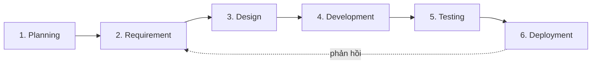

# BA Plan và phương pháp dự án — HL-OMS

| Mục | Nội dung |
|---|---|
| Dự án | HL Restaurant Order Management System (HL-OMS) |
| Khách hàng | HL Restaurant, Sydney CBD |
| Phiên bản | 1.0 — 27/10/2026 |
| Người lập | BA — công ty phần mềm |
| Người duyệt | PM (vendor) · Chủ nhà hàng (HL) |

## 1. Vòng đời SDLC và hoạt động BA

| Pha | Hoạt động BA | Sản phẩm BA | Thời gian |
|---|---|---|---|
| 1. Planning | Nhận đề bài, BACCM, chọn phương pháp, lập BA Plan, chuẩn bị họp 1 | BACCM, BA Plan, Meeting Pack, Question Log | 20/10–03/11/2026 |
| 2. Requirement | Elicitation (phỏng vấn, quan sát, khảo sát, review tài liệu); phân tích stakeholder, rủi ro, NFR; User Story + Story Map | MOM, Stakeholder/Risk/RACI, NFR, Product Backlog | 03/11–20/11/2026 |
| 3. Design | BPMN As-Is/To-Be, Use Case + UCS, Activity, BFD, State Machine, Sitemap, Wireframe | BRD, SRS, prototype | 09/11–27/11/2026 |
| 4. Development | Làm rõ story trong sprint, refine backlog, duyệt demo, quản lý thay đổi | Backlog đã refine, CR Log | 30/11/2026–12/02/2027 |
| 5. Testing | Viết UAT test case từ AC/UCS, hỗ trợ khách chạy UAT, phân loại lỗi | UAT Test Cases, UAT Report, RTM | 15/02–26/02/2027 |
| 6. Deployment | Tài liệu hướng dẫn, đào tạo, hỗ trợ go-live, thu thập phản hồi đo KPI | User Guide, Go-live checklist, Benefit Review | 01/03–28/03/2027 |

## 2. Chọn phương pháp

| Tiêu chí | Waterfall | Scrum | Với HL-OMS |
|---|---|---|---|
| Độ ổn định yêu cầu | Cần chốt đủ từ đầu | Chấp nhận thay đổi theo sprint | Yêu cầu còn đổi sau khi nhân viên dùng thử → Scrum |
| Thời điểm có sản phẩm dùng được | Cuối dự án | Sau mỗi sprint | Chủ NH muốn xem sớm → Scrum |
| Mức tham gia của khách | Đầu và cuối | Liên tục (review mỗi 2 tuần) | Quản lý có mặt hằng ngày, làm PO được → Scrum |
| Tài liệu hợp đồng | Đầy đủ, ký một lần | Gọn, sống trong backlog | Cần BRD/SRS để ký phạm vi và nghiệm thu → bổ sung |
| Rủi ro tích hợp thiết bị (KDS, máy in) | Phát hiện muộn | Phát hiện ở sprint đầu | Rủi ro cao → Scrum |

**Quyết định (D-01):** Scrum, sprint 2 tuần, có **giai đoạn Discovery 4 tuần** trước Sprint 1 để chốt BRD/SRS mức đủ ký hợp đồng. Chi tiết trong từng story được làm rõ ở mỗi sprint.

## 3. Khung Scrum

| Vai trò | Người đảm nhận | Trách nhiệm chính |
|---|---|---|
| Product Owner | Quản lý nhà hàng (HL) | Sắp ưu tiên backlog, chấp nhận story |
| Sponsor / người duyệt cuối | Chủ nhà hàng (HL) | Duyệt phạm vi, ngân sách, nghiệm thu |
| Scrum Master | PM (vendor) | Điều phối, gỡ vướng |
| BA | BA (vendor) | Elicitation, viết story + AC, BRD/SRS, UAT; hỗ trợ PO |
| Dev Team | 2 FE, 1 BE, 1 QA (vendor) | Xây dựng, kiểm thử |

Thời lượng theo Scrum Guide, quy đổi cho sprint 2 tuần (tối đa bằng một nửa mức của sprint 1 tháng).

| Sự kiện | Tần suất | Thời lượng | Thành phần |
|---|---|---|---|
| Sprint Planning | Đầu sprint | 4 giờ | PO, BA, Dev, SM |
| Daily Scrum | Hằng ngày | 15 phút | Dev, SM, BA |
| Backlog Refinement | Giữa sprint | 1 giờ | PO, BA, Dev |
| Sprint Review (demo tại nhà hàng) | Cuối sprint | 2 giờ | PO, OWN, CHF, BA, Dev |
| Retrospective | Cuối sprint | 1,5 giờ | Dev, SM, BA |

**Lịch release:**

| Giai đoạn | Thời gian | Kết quả |
|---|---|---|
| Discovery | 03/11–27/11/2026 | BRD, SRS, prototype được duyệt |
| Sprint 1 | 30/11–11/12/2026 | Menu, bàn, tài khoản |
| Sprint 2 | 14/12–23/12/2026 | Tạo đơn, gửi bếp |
| Nghỉ lễ | 24/12/2026–03/01/2027 | — |
| Sprint 3 | 04/01–15/01/2027 | KDS, trạng thái món, hết món, thông báo |
| Sprint 4 | 18/01–29/01/2027 | Bill, thanh toán, tách bill, GST/phụ thu |
| Sprint 5 | 01/02–12/02/2027 | Báo cáo, nhật ký, vận hành khi mất mạng |
| UAT + đào tạo | 15/02–26/02/2027 | UAT ký nghiệm thu |
| Go-live | 01/03/2027 | Chạy thật |
| Hypercare | 01/03–28/03/2027 | Hỗ trợ tại chỗ ca tối T6–T7 |

## 4. Kế hoạch BA

| Hạng mục | Cách làm |
|---|---|
| Tiếp cận | Lai: tài liệu nền (BRD/SRS) chốt ở Discovery; chi tiết sống trong Product Backlog |
| Stakeholder | Phân tích ảnh hưởng/quan tâm ở GĐ4; kênh: họp tại nhà hàng ngoài giờ cao điểm (14:30–16:30), nhóm chat dự án, demo cuối sprint |
| Elicitation | Vòng lặp: cần thông tin → chuẩn bị câu hỏi → elicit → nhận thông tin. Phỏng vấn → quan sát ca tối → khảo sát nhân viên → review tài liệu → interface analysis → workshop phạm vi (xem [Elicitation Plan](../01_BACCM_Elicitation/02_Elicitation-Plan.md)) |
| Mã truy vết | `BN` Business Need · `US` User Story · `BR` Business Rule · `NFR` · `BP` quy trình · `UC` Use Case · `F` Function · `SCR` màn hình · `TC` test case · `A`/`Q`/`D`/`CR`/`RK` log |
| Thuộc tính yêu cầu | ID · nguồn · độ ưu tiên (MoSCoW) · trạng thái · người duyệt · liên kết |
| Truy vết | Ma trận BN → US → UC → F → SCR → TC, cập nhật mỗi khi thêm/sửa yêu cầu |
| Thay đổi | Trong sprint: PO đưa vào backlog. Thay đổi phạm vi đã ký (BRD/SRS): ghi [Change Log](Change-Log.md), đánh giá tác động chi phí/tiến độ, OWN duyệt |
| Quản lý thông tin | Cây thư mục `00`–`09`; tên file `{số}_{Tên-tài-liệu}`; mọi tài liệu ghi phiên bản, ngày, người duyệt; Git giữ lịch sử |
| Duyệt | BRD: OWN ký · SRS: PO + PM ký · UAT: OWN ký |
| Công cụ | Markdown + Mermaid (tài liệu, sơ đồ) · BPMN 2.0 · prototype HTML · Excel (log, RTM, UAT) · PowerPoint (họp, pitching) |
| Đo hiệu quả công việc BA | Story bị trả lại vì thiếu AC ≤ 10% · Lỗi UAT do yêu cầu sai ≤ 5% · 100% yêu cầu có truy vết tới TC |

## 5. Rủi ro của công việc BA

| ID | Rủi ro | Ứng phó |
|---|---|---|
| RK-BA-01 | Nhân viên bếp, phục vụ ít thời gian tham gia | Quan sát tại chỗ thay phỏng vấn dài; lịch ngoài giờ cao điểm |
| RK-BA-02 | Chủ NH và Quản lý ưu tiên khác nhau | PO duy nhất là Quản lý; OWN duyệt phạm vi ở mốc Discovery |
| RK-BA-03 | Yêu cầu tuân thủ Úc (GST, phụ thu, dị ứng) bị hiểu sai | Kế toán xác nhận mẫu bill (AI-04); dẫn nguồn quy định trong BRD |
