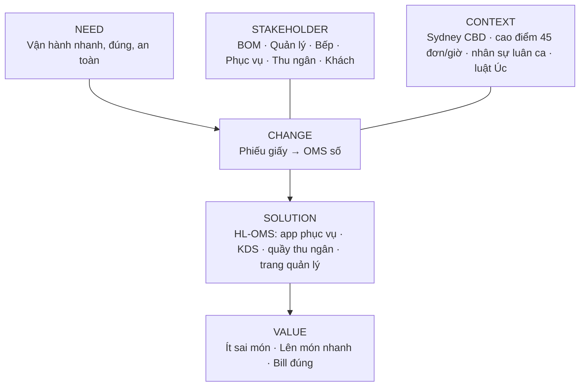

# BACCM — HL-OMS

| Mục | Nội dung |
|---|---|
| Phiên bản | 1.1 — 04/11/2026 (bổ sung số liệu baseline sau MOM-01; bản 1.0 ngày 27/10/2026 dùng giả định) |
| Khung | BACCM™ (BABOK v3): Need · Change · Solution · Stakeholder · Value · Context |

## 1. Phát biểu vấn đề

| Vấn đề | Gọi món và chuyển đơn vào bếp bằng phiếu giấy |
|---|---|
| Ảnh hưởng tới | Khách, phục vụ, bếp, thu ngân, chủ nhà hàng |
| Hậu quả | Sai/sót 3–5 món/ngày (~AUD 900/tháng làm lại) · Món đầu tiên lên bàn sau TB 22 phút giờ cao điểm · Bill sai 1–2 lần/tuần · 2 sự cố dị ứng suýt xảy ra/năm |
| Giải pháp thành công khi | Đơn đi thẳng từ phục vụ tới đúng trạm bếp, trạng thái từng món hiển thị theo thời gian thực, bill tự tính đúng GST và phụ thu |

## 2. Sáu khái niệm cốt lõi

| Khái niệm | Câu hỏi | HL-OMS |
|---|---|---|
| **Need** | Vấn đề hay cơ hội nào cần xử lý? | BN-01 → BN-07 (mục 3) |
| **Change** | Thay đổi gì? | Gọi món giấy → gọi món trên điện thoại · Chạy phiếu → đơn tự tới đúng trạm bếp · Gọi to → thông báo trên điện thoại · Cộng tay → bill tự tính · Ghi chú dị ứng ở lề phiếu → trường bắt buộc, cảnh báo đỏ |
| **Solution** | Cách đáp ứng Need? | Web app (PWA) 4 phân hệ: **Phục vụ** (sơ đồ bàn, gọi món) · **Bếp/KDS** (theo trạm, trạng thái món, hết món) · **Thu ngân** (bill, tách bill, GST, phụ thu, ghi nhận TT) · **Quản lý** (menu, báo cáo, tài khoản, nhật ký) |
| **Stakeholder** | Ai liên quan? | 8 nhóm — bảng mục 4 |
| **Value** | Giá trị đo được? | Mục 5 |
| **Context** | Môi trường ảnh hưởng? | Nhà hàng Việt, Sydney CBD, 22 bàn, ~80 chỗ · Cao điểm tối T6–T7 45 đơn/giờ · ~40% nhân viên bán thời gian, nghỉ ~3 người/quý · Internet mất 2–3 lần/tháng · Quy định Úc: giá gồm GST 10%, tax invoice khi khách yêu cầu, ghi rõ phụ thu trên menu (ACCC), cung cấp thông tin dị ứng (FSANZ Std 1.2.3), Privacy Act 1988 |

## 3. Business Needs

| ID | Nhu cầu | Baseline (MOM-01) | Mục tiêu 6 tháng sau go-live |
|---|---|---|---|
| BN-01 | Giảm sai/sót món | 3–5 lần/ngày | ≤ 1 lần/ngày (giảm ≥ 80%) |
| BN-02 | Rút ngắn thời gian lên món | TB 22 phút giờ cao điểm | TB ≤ 15 phút |
| BN-03 | Bill chính xác, đúng GST và phụ thu | Sai 1–2 lần/tuần | 0 |
| BN-04 | Kiểm soát hết món, hủy món, giảm giá | Không ghi nhận, báo miệng | 100% hủy/giảm giá có lý do và người duyệt |
| BN-05 | An toàn dị ứng | 2 sự cố suýt xảy ra/năm | 0 sự cố; 100% đơn có dị ứng được bếp xác nhận |
| BN-06 | Có số liệu quản trị | Cộng sổ cuối ca | Báo cáo ngày có sẵn ≤ 5 phút sau đóng ca |
| BN-07 | Tăng quay vòng bàn ca tối | Đo ở tuần quan sát | +10% |

## 4. Stakeholder

| Stakeholder | Vai trò dự án | Quan tâm chính | RACI |
|---|---|---|---|
| Chủ nhà hàng / BOM | Sponsor, người duyệt cuối | ROI, doanh thu, chi phí | A |
| Quản lý nhà hàng | Product Owner, Admin hệ thống | Vận hành trơn tru, báo cáo | R |
| Bếp trưởng | Tư vấn nghiệp vụ bếp + người dùng KDS | Đơn rõ ràng, điều phối trạm | C |
| Bếp | Người dùng KDS | Đọc đơn dễ, ít nhầm | C |
| Phục vụ | Người dùng app gọi món | Thao tác nhanh, ít chạy | C |
| Thu ngân | Người dùng màn thu ngân | Bill chính xác | C |
| Khách hàng | Bị tác động | Lên món nhanh, đúng, an toàn dị ứng | I |
| Vendor (PM, BA, Dev, QA) | Đội dự án | Yêu cầu rõ, ổn định | R |

## 5. Value

| Giá trị | Cách đo | Ước tính năm đầu |
|---|---|---|
| Giảm chi phí làm lại món | Số món làm lại × giá vốn | ~AUD 8.600 (≥ 80% × AUD 900 × 12 tháng) |
| Tăng doanh thu do quay vòng bàn | Số lượt bàn ca tối × doanh thu TB/bàn | Tính ở Business Case (GĐ10) sau tuần quan sát |
| Giảm thời gian chạy phiếu | Số lần chạy phiếu × 2–3 phút | Phục vụ có thêm thời gian ở khu bàn |
| Giảm rủi ro pháp lý, uy tín | Sự cố dị ứng, khiếu nại bill | Định tính |

## 6. Nguồn quy định tham khảo

| Chủ đề | Nguồn |
|---|---|
| Phụ thu trên menu | ACCC — <https://www.accc.gov.au/media-release/misleading-menus-invite-infringement-notices> |
| Tax invoice ≥ AUD 82,50 khi khách yêu cầu | ATO — <https://www.ato.gov.au/General/Sharing-economy-and-tax/Ride-sourcing/Tax-invoices/> (ví dụ áp dụng chung ngưỡng) |
| Thông tin dị ứng cho món không đóng gói | FSANZ / Health VIC — <https://www.health.vic.gov.au/food-safety/food-allergen-awareness> |

> Nguồn ghi để định hướng yêu cầu; kế toán của HL xác nhận mẫu bill (AI-04) trước khi chốt BRD.
