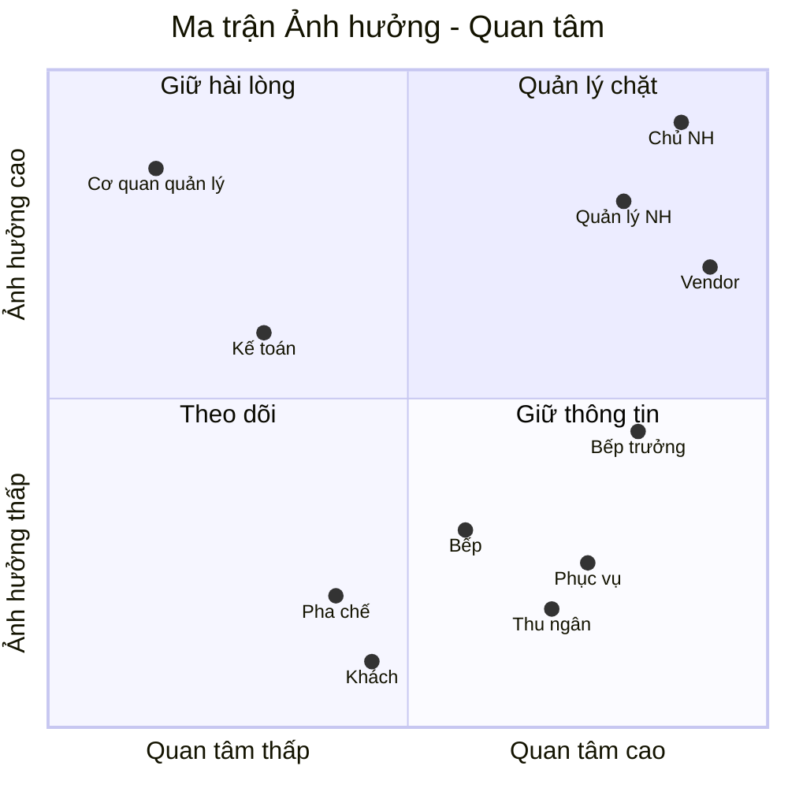

# Stakeholder Analysis — HL-OMS

## 1. Danh sách stakeholder

| ID | Stakeholder | Nhóm | Số người | Vai trò dự án | Quan tâm chính | Ảnh hưởng | Quan tâm | Thái độ hiện tại | Chiến lược |
|---|---|---|---|---|---|---|---|---|---|
| SH-01 | Chủ nhà hàng (BOM) | BOM | 1 | Sponsor, duyệt cuối | ROI, chi phí, doanh thu | Cao | Cao | Ủng hộ | Quản lý chặt: duyệt phạm vi, demo mỗi sprint |
| SH-02 | Quản lý nhà hàng | Nhân viên quản lý | 1 | Product Owner, Admin | Vận hành, báo cáo, kiểm soát | Cao | Cao | Ủng hộ | Quản lý chặt: refinement hằng tuần |
| SH-03 | Bếp trưởng | Người dùng chính | 1 | Chuyên gia nghiệp vụ bếp | Đơn rõ, điều phối, an toàn dị ứng | Trung bình | Cao | Trung lập — lo màn hình chậm hơn đọc phiếu | Giữ thông tin: tham gia thiết kế KDS, dùng thử sớm |
| SH-04 | Bếp | Người dùng | 3 | Người dùng KDS | Đọc đơn dễ, ít nhầm | Thấp | Trung bình | Trung lập | Giữ thông tin: đào tạo tại chỗ |
| SH-05 | Phục vụ | Người dùng | 4–6/ca | Người dùng app | Ít chạy, biết món xong | Thấp | Cao | Ủng hộ (EL-04: 87% tự tin) | Giữ thông tin: user testing prototype |
| SH-06 | Thu ngân | Người dùng | 1–2 | Người dùng màn thu ngân | Bill đúng, chốt ca nhanh | Thấp | Cao | Ủng hộ | Giữ thông tin |
| SH-07 | Pha chế | Người dùng | 1 | Người dùng tablet Quầy nước | Đơn nước rõ ràng | Thấp | Trung bình | Trung lập | Theo dõi |
| SH-08 | Kế toán thuê ngoài | Nhà cung cấp dịch vụ | 1 | Tư vấn GST, tax invoice | Hóa đơn đúng luật, số liệu xuất được | Trung bình | Thấp | Trung lập | Giữ hài lòng: xác nhận mẫu bill, mẫu CSV |
| SH-09 | Khách hàng | Khách | ~250/ngày | Bị tác động | Lên món nhanh, đúng, an toàn | Thấp | Trung bình | — | Theo dõi qua đánh giá Google |
| SH-10 | Vendor: PM, BA, Dev, QA | Đội dự án | 6 | Thực hiện | Yêu cầu rõ, ổn định | Cao | Cao | — | Phối hợp hằng ngày |
| SH-11 | Cơ quan quản lý (ATO, ACCC, NSW Food Authority) | Cộng đồng/quy định | — | Đặt ràng buộc pháp lý | GST, ghi giá, thông tin dị ứng | Cao | Thấp | — | Giữ hài lòng: tuân thủ trong BR |

## 2. Ma trận Ảnh hưởng — Quan tâm

| Ô | Stakeholder | Cách làm việc |
|---|---|---|
| Quản lý chặt | Chủ NH, Quản lý NH, Vendor | Họp định kỳ, duyệt từng mốc |
| Giữ hài lòng | Cơ quan quản lý, Kế toán | Đưa yêu cầu tuân thủ vào BR, kế toán xác nhận |
| Giữ thông tin | Bếp trưởng, Phục vụ, Thu ngân, Bếp | Demo, user testing, đào tạo |
| Theo dõi | Pha chế, Khách | Phản hồi sau go-live |
