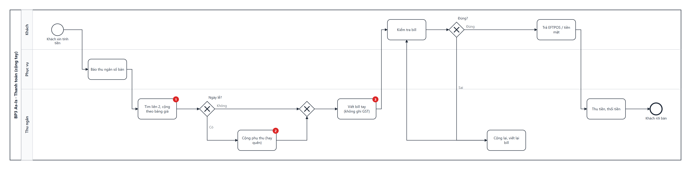
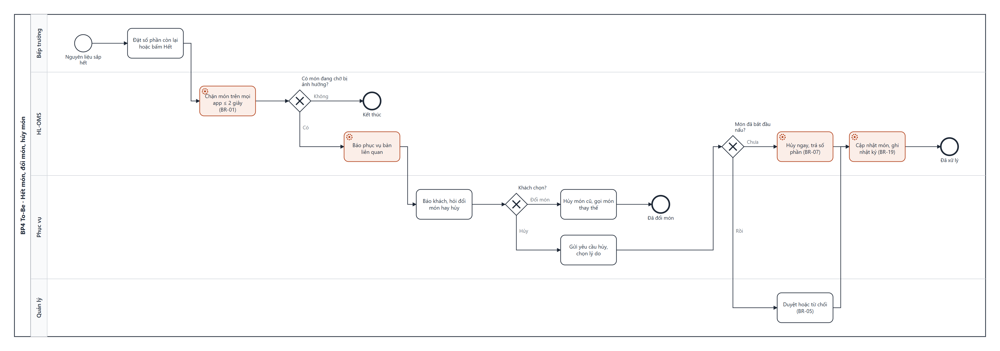
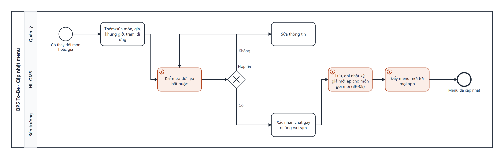

# Business Process Analysis — HL-OMS

| Mục | Nội dung |
|---|---|
| Phương pháp | 4 bước: Xác định quy trình → Thu thập thông tin → Phân tích As-Is → Đề xuất To-Be |
| Ký hiệu | BPMN 2.0, pool + swimlane. Task trắng = người làm · Task cam có bánh răng = hệ thống làm · ◇✕ cổng XOR · ◇+ cổng song song · Chấm đỏ số = điểm đau As-Is |
| File gốc | `diagrams/*.bpmn` mở được bằng [bpmn.io](https://demo.bpmn.io) hoặc Camunda Modeler (đã kiểm import bằng bpmn-js 17.11.1, 0 cảnh báo) · `*.svg`, `*.png` để xem nhanh |
| Sinh lại | `python tools/build_bpmn.py` |

## 1. Xác định quy trình

| ID | Quy trình | Loại | Lane | Business Case | Sơ đồ |
|---|---|---|---|---|---|
| BP1 | Gọi món tại bàn | Operational | Khách · Phục vụ · Bếp · Thu ngân · HL-OMS | BC-01, BC-02 | As-Is + To-Be |
| BP2 | Chế biến và lên món | Operational | Bếp · Bếp trưởng · HL-OMS · Phục vụ · Khách | BC-03 | To-Be |
| BP3 | Thanh toán | Operational | Khách · Phục vụ · Thu ngân · HL-OMS · Quản lý | BC-05 | As-Is + To-Be |
| BP4 | Xử lý hết món, đổi món, hủy món | Operational | Bếp trưởng · HL-OMS · Phục vụ · Quản lý | BC-04 | To-Be |
| BP5 | Cập nhật menu | Supporting | Quản lý · HL-OMS · Bếp trưởng | BC-06 | To-Be |

Nguồn thông tin (bước 2): MOM-01, quan sát ca tối 06/11 (EL-03), review phiếu/hóa đơn (EL-02) — [Elicitation Results](../01_BACCM_Elicitation/04_Elicitation-Results.md).

## 2. BP1 — Gọi món tại bàn

### As-Is

| # | Điểm đau | Bằng chứng | BN |
|---|---|---|---|
| 1 | Chữ khó đọc, ghi tắt, thiếu số bàn | 41 phiếu ghi tắt, 9 phiếu thiếu số bàn/912 (EL-02) | BN-01 |
| 2 | Ghi chú dị ứng ở lề, dễ bị che hoặc sót | 1/3 ghi chú bị vết dầu che (EL-03) | BN-05 |
| 3 | Phục vụ chạy phiếu 2–3 phút/lần | 38 vòng/3 giờ ≈ 95 phút đi bộ (EL-03) | BN-02 |
| 4 | Liên 2 thất lạc → bill thiếu món | 1 lần trong buổi quan sát | BN-03 |
| 5 | Phiếu chờ trên móc TB 3 phút, tối đa 7 phút | EL-03 | BN-02 |
| 6 | Hết món báo miệng, khách biết muộn 10–15 phút | Cá kho tộ, bàn T07 chờ 12 phút | BN-04 |

### To-Be

| Bước | Ai | Mô tả | Quy tắc |
|---|---|---|---|
| 1 | Phục vụ | Mở bàn, nhập số khách | BR-02 |
| 2 | Phục vụ | Chọn món, tùy chọn, ghi chú theo lời khách | BR-08 |
| 3 | HL-OMS | Kiểm tra món còn bán, còn phần; hết → báo ngay, khách chọn lại | BR-01 |
| 4 | Phục vụ | Khai báo chất gây dị ứng (nếu có) | BR-04 |
| 5 | Phục vụ | Bấm Gửi bếp | BR-02 |
| 6 | HL-OMS | Chia món theo trạm, trừ số phần còn lại | BR-03, BR-07 |
| 7 | Bếp | Nhận đơn trên KDS ≤ 2 giây → BP2 | NFR-01 |

**Ngoại lệ:** mất internet → chạy mạng nội bộ (US-35); khách gọi thêm → lặp bước 2–7 trên cùng đơn (US-08); mang về → thu ngân tạo đơn TA-xx, thu tiền trước rồi mới gửi bếp (BR-13).

## 3. BP2 — Chế biến và lên món (To-Be)

| Bước | Ai | Mô tả | Quy tắc |
|---|---|---|---|
| 1 | Bếp | Xem phiếu của trạm theo thứ tự thời gian | BR-03 |
| 2 | Bếp | Món có dị ứng: đọc và bấm xác nhận trước khi nấu | BR-04 |
| 3 | Bếp | Bấm Đang nấu | — |
| 4 | HL-OMS | Đếm thời gian, đổi màu cam/đỏ khi vượt ngưỡng trạm | BR-06 |
| 5 | Bếp trưởng | Món trễ: ưu tiên, điều phối người | — |
| 6 | Bếp | Bấm Sẵn sàng | — |
| 7 | HL-OMS | Báo phục vụ phụ trách bàn (rung + thông báo), nhắc lại sau 2 phút | — |
| 8 | Phục vụ | Lấy món, mang ra, xác nhận Đã phục vụ | — |

**Ngoại lệ:** KDS lỗi → in phiếu ra máy in dự phòng (NFR-08); bếp bấm nhầm → bếp trưởng trả món về trạng thái trước (AC-17.2).

## 4. BP3 — Thanh toán

### As-Is

| # | Điểm đau | Bằng chứng | BN |
|---|---|---|---|
| 1 | Cộng tay theo bảng giá, 2–4 phút/bàn | EL-03 | BN-03 |
| 2 | Quên phụ thu ngày lễ | 2/50 hóa đơn ngày lễ không có phụ thu (EL-02) | BN-03 |
| 3 | Bill không ghi phần GST | 50/50 hóa đơn (EL-02) | BN-03 |

### To-Be

| Bước | Ai | Mô tả | Quy tắc |
|---|---|---|---|
| 1 | Thu ngân | Mở bill của bàn | BR-12 |
| 2 | HL-OMS | Tính tạm tính, phụ thu ngày lễ, GST | BR-09, BR-10 |
| 3 | Thu ngân | Tách bill theo món hoặc chia đều (nếu khách yêu cầu) | BR-14 |
| 4 | Thu ngân | Áp giảm giá ≤ 10%; vượt 10% → Quản lý duyệt | BR-11 |
| 5 | Khách | Xác nhận bill, thanh toán | — |
| 6 | Thu ngân | Ghi nhận phương thức, số tiền; in hóa đơn/tax invoice | BR-15, BR-16 |
| 7 | HL-OMS | Đóng bill, bàn chuyển Cần dọn | BR-17 |

**Ngoại lệ:** còn món chưa phục vụ → không chốt được bill (BR-12); khách trả thiếu → bill giữ "Thanh toán một phần"; Quản lý từ chối giảm giá → bill giữ giá gốc.

## 5. BP4 — Hết món, đổi món, hủy món (To-Be)

| Bước | Ai | Mô tả | Quy tắc |
|---|---|---|---|
| 1 | Bếp trưởng | Đặt số phần còn lại hoặc bấm Hết | BR-07 |
| 2 | HL-OMS | Chặn món trên mọi app ≤ 2 giây | BR-01 |
| 3 | HL-OMS | Có món đang chờ bị ảnh hưởng → báo phục vụ bàn liên quan | — |
| 4 | Phục vụ | Báo khách; khách chọn đổi món hoặc hủy | — |
| 5a | Phục vụ | Đổi món: hủy món cũ, gọi món thay thế | BR-05 |
| 5b | Phục vụ | Hủy: gửi yêu cầu, chọn lý do | BR-05 |
| 6 | HL-OMS / Quản lý | Món chưa nấu → hủy ngay, trả số phần; đã nấu → Quản lý duyệt/từ chối | BR-05, BR-07 |
| 7 | HL-OMS | Cập nhật món, ghi nhật ký | BR-19 |

## 6. BP5 — Cập nhật menu (To-Be)

| Bước | Ai | Mô tả | Quy tắc |
|---|---|---|---|
| 1 | Quản lý | Thêm/sửa món, giá, khung giờ, trạm, chất gây dị ứng | — |
| 2 | HL-OMS | Kiểm tra bắt buộc: tên EN/VI, danh mục, giá > 0, trạm | — |
| 3 | Bếp trưởng | Xác nhận chất gây dị ứng và trạm của món | BR-04 |
| 4 | HL-OMS | Lưu, ghi nhật ký; giá mới chỉ áp cho món gọi sau thời điểm lưu | BR-08, BR-19 |
| 5 | HL-OMS | Đẩy menu mới tới mọi app | — |

## 7. Giá trị As-Is → To-Be

| Chỉ số | As-Is (đo) | To-Be (mục tiêu) | Cơ sở |
|---|---|---|---|
| Thời gian đơn tới bếp | 5–10 phút (chạy phiếu 2–3' + chờ móc 3–7') | ≤ 2 giây | NFR-01 |
| Đi bộ đưa phiếu / ca tối | ≈ 95 phút (4 phục vụ) | 0 | BP1 To-Be bỏ bước |
| Món xong chờ người mang | TB 4 phút | ≤ 1 phút (thông báo tức thì) | US-12 |
| Khách biết món hết | Sau 10–15 phút | Ngay lúc gọi | BR-01 |
| Cộng bill | 2–4 phút/bàn | ≤ 30 giây | BR-09, BR-10 |
| Hóa đơn có GST | 0% | 100% | BR-09 |
| Gọi món → món đầu tiên | TB 21–22 phút | ≤ 15 phút | BN-02 |
