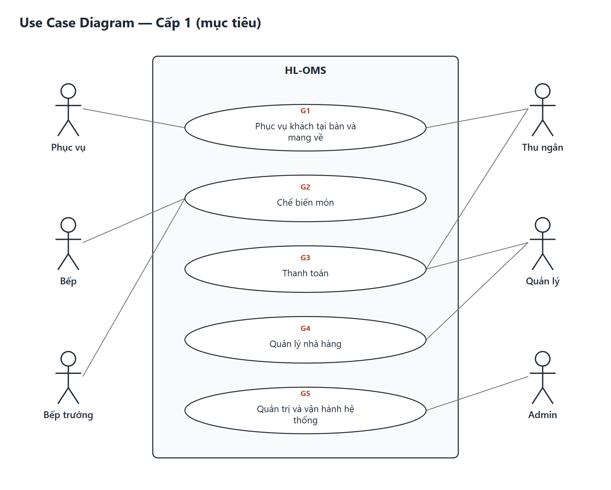
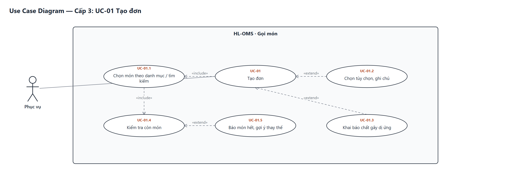
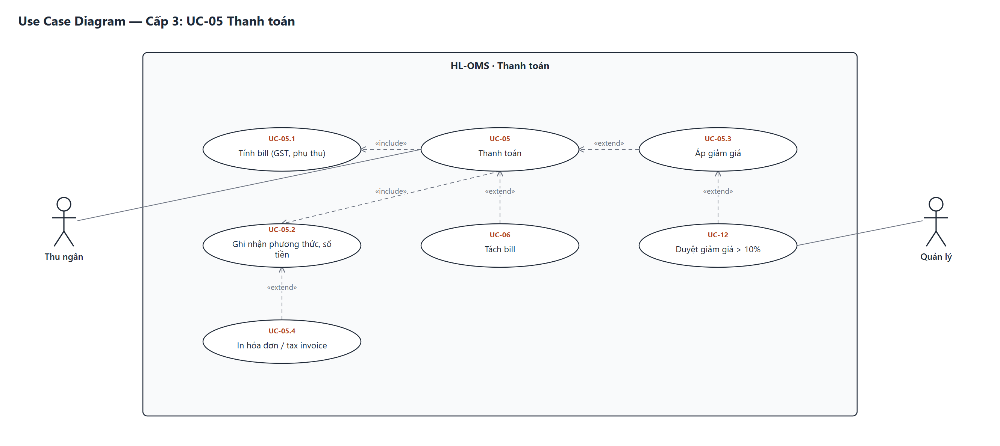

# Use Case Diagram — HL-OMS

| Mục | Nội dung |
|---|---|
| Kỹ thuật | User Goal: xác định actor → mục tiêu (Epic) → hoạt động hoàn thành mục tiêu (Use Case) |
| Cấp | Cấp 1 mục tiêu · Cấp 2 use case hệ thống · Cấp 3 phân rã cho UC quan trọng (UC-01, UC-05) |
| Truy vết | Mỗi Use Case xuất phát từ ít nhất một User Story ([Product Backlog](../03_User_Story/01_Product-Backlog.md)) |
| Sinh lại | `python tools/build_uml.py` |

## 1. Actor

| Actor | Loại | Mô tả |
|---|---|---|
| Phục vụ (Waiter) | Chính | Mở bàn, gọi món, gửi bếp, nhận thông báo, mang món |
| Bếp (Cook) | Chính | Nhận món theo trạm, cập nhật trạng thái |
| Bếp trưởng (Chef) | Chính | Làm mọi việc của Bếp + điều phối, báo hết món |
| Thu ngân (Cashier) | Chính | Bill, giảm giá, tách bill, thu tiền, mang về, chốt ca |
| Quản lý (Manager) | Chính | Duyệt yêu cầu, menu, ngày lễ, báo cáo |
| Admin | Chính | Tài khoản, vai trò, nhật ký |
| Đồng hồ hệ thống | Phụ | Kích hoạt cảnh báo món trễ, nhắc thông báo sau 2 phút |

## 2. Cấp 1 — Mục tiêu

| Mục tiêu | Epic | Use Case cấp 2 |
|---|---|---|
| G1 Phục vụ khách tại bàn và mang về | EP-01, EP-02, EP-03 | UC-01, UC-02, UC-07, UC-08, UC-09, UC-10 |
| G2 Chế biến món | EP-04, EP-05 | UC-03, UC-04, UC-11 |
| G3 Thanh toán | EP-06 | UC-05, UC-06, UC-16 |
| G4 Quản lý nhà hàng | EP-07, EP-08 | UC-12, UC-13, UC-14, UC-15 |
| G5 Quản trị và vận hành | EP-09, EP-10 | UC-17, UC-18, UC-19, UC-20 |

## 3. Cấp 2 — Use Case hệ thống

UC-19 Đăng nhập bằng PIN áp cho mọi actor (để sơ đồ gọn, không vẽ đường nối).

| ID | Use Case | Actor chính | User Story | Ưu tiên | UCS |
|---|---|---|---|---|---|
| UC-01 | Tạo đơn | Phục vụ | US-04, US-05, US-06, US-08, US-14 | High | [UCS-01](03_UCS/UCS-01_Tao-don.md) |
| UC-02 | Gửi đơn tới bếp | Phục vụ | US-07 | High | [UCS-02](03_UCS/UCS-02_Gui-don-toi-bep.md) |
| UC-03 | Cập nhật trạng thái món | Bếp, Bếp trưởng | US-15, US-16, US-17, US-18 | High | [UCS-03](03_UCS/UCS-03_Cap-nhat-trang-thai-mon.md) |
| UC-04 | Báo hết món | Bếp trưởng | US-20 | High | [UCS-04](03_UCS/UCS-04_Bao-het-mon.md) |
| UC-05 | Thanh toán | Thu ngân | US-21, US-22, US-24 | High | [UCS-05](03_UCS/UCS-05_Thanh-toan.md) |
| UC-06 | Tách bill | Thu ngân | US-23 | High | [UCS-06](03_UCS/UCS-06_Tach-bill.md) |
| UC-07 | Quản lý bàn | Phục vụ | US-01, US-02, US-03 | High | SRS §4 |
| UC-08 | Hủy món | Phục vụ | US-09, US-10 | High | [UCS-08](03_UCS/UCS-08_Huy-mon.md) |
| UC-09 | Nhận thông báo, phục vụ món | Phục vụ | US-12, US-13 | High | SRS §4 |
| UC-10 | Tạo đơn mang về | Thu ngân | US-11 | Medium | SRS §4 |
| UC-11 | Xem tổng hợp bếp | Bếp trưởng | US-19 | Medium | SRS §4 |
| UC-12 | Duyệt yêu cầu | Quản lý | US-29 | High | SRS §4 |
| UC-13 | Quản lý menu | Quản lý | US-26, US-27 | High | SRS §4 |
| UC-14 | Thiết lập ngày lễ, phụ thu | Quản lý | US-28 | High | SRS §4 |
| UC-15 | Xem báo cáo | Quản lý | US-30, US-31, US-32 | Medium | SRS §4 |
| UC-16 | Chốt ca | Thu ngân | US-25 | Medium | SRS §4 |
| UC-17 | Quản lý tài khoản, vai trò | Admin | US-33 | High | SRS §4 |
| UC-18 | Xem nhật ký thao tác | Admin | US-34 | Medium | SRS §4 |
| UC-19 | Đăng nhập bằng PIN | Mọi actor | US-33 | High | SRS §4 |
| UC-20 | Vận hành khi mất mạng | Phục vụ, Bếp | US-35 | High | SRS §4 |

Kiểm tra truy vết: 35/35 User Story MVP có Use Case (xem [RTM](../08_Documents/RTM.md)).

## 4. Cấp 3 — Phân rã

### UC-01 Tạo đơn

| Quan hệ | Ý nghĩa |
|---|---|
| UC-01 «include» UC-01.1 Chọn món | Luôn xảy ra |
| UC-01.1 «include» UC-01.4 Kiểm tra còn món | Mỗi lần chọn món đều kiểm tra (BR-01) |
| UC-01.5 Báo món hết «extend» UC-01.4 | Chỉ khi món hết |
| UC-01.2 Tùy chọn, ghi chú «extend» UC-01 | Khi món có tùy chọn hoặc khách có yêu cầu |
| UC-01.3 Khai báo dị ứng «extend» UC-01 | Khi khách có dị ứng |

### UC-05 Thanh toán

| Quan hệ | Ý nghĩa |
|---|---|
| UC-05 «include» UC-05.1 Tính bill | Luôn tính GST, phụ thu (BR-09, BR-10) |
| UC-05 «include» UC-05.2 Ghi nhận phương thức | Luôn ghi nhận EFTPOS/tiền mặt |
| UC-05.3 Áp giảm giá «extend» UC-05 | Khi có giảm giá |
| UC-12 Duyệt «extend» UC-05.3 | Khi giảm > 10% hoặc miễn phí món (BR-11) |
| UC-06 Tách bill «extend» UC-05 | Khi khách trả riêng (BR-14) |
| UC-05.4 In tax invoice «extend» UC-05.2 | Khi khách yêu cầu (BR-16) |
