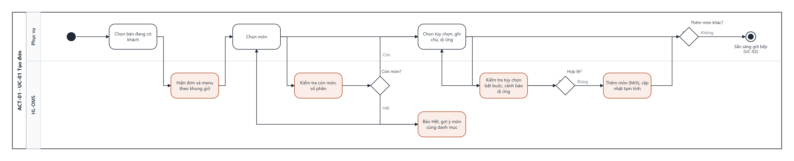

# UCS-01 — Tạo đơn (Create Order)

| Mục | Nội dung |
|---|---|
| **Use Case ID** | UC-01 |
| **Use Case Name** | Tạo đơn |
| **Actor** | Phục vụ (chính) · Thu ngân, Quản lý (được phép) |
| **Description** | Phục vụ ghi nhận món khách gọi cho một bàn đang có khách: chọn món, tùy chọn, ghi chú, chất gây dị ứng. Kết quả là đơn có các món trạng thái **Mới**, sẵn sàng gửi bếp (UC-02) |
| **Priority** | High |
| **Trigger** | Phục vụ chạm bàn Có khách trên Sơ đồ bàn (SCR-02) rồi chạm "Gọi món" |
| **Pre-condition** | 1. Phục vụ đã đăng nhập (UC-19). 2. Bàn ở trạng thái Có khách (UC-07). 3. Menu đã có dữ liệu (UC-13) |
| **Post-condition** | Thành công: đơn của bàn có ≥ 1 món Mới, tạm tính cập nhật. Thất bại: đơn giữ nguyên, không món nào bị thêm |
| **Màn hình** | SCR-02 Sơ đồ bàn · SCR-03 Gọi món · SCR-04 Chi tiết món · SCR-05 Đơn của bàn |
| **Truy vết** | US-04, US-05, US-06, US-08, US-14 · AC-04.1–04.3, AC-05.1–05.3, AC-06.1–06.3, AC-08.1, AC-14.1–14.2 |

## Basic Flow

| # | Actor | Hệ thống |
|---|---|---|
| 1 | Chạm bàn Có khách → "Gọi món" | Hiện SCR-03: 9 danh mục, giá theo khung giờ hiện hành (BR-08), món hết hiện mờ (BR-01) |
| 2 | Chọn danh mục hoặc gõ tìm tên món | Lọc theo tên EN/VI, không phân biệt dấu |
| 3 | Chạm món | Kiểm tra còn bán và số phần (BR-01) → mở SCR-04 |
| 4 | Chọn tùy chọn (độ cay, cỡ, topping), nhập ghi chú, chọn số lượng | Cộng giá tùy chọn vào giá món |
| 5 | Chọn chất gây dị ứng của khách (nếu có) | Món chứa sẵn chất đó → hiện cảnh báo vàng "Món có chứa …" |
| 6 | Chạm "Thêm vào đơn" | Kiểm tra tùy chọn bắt buộc; thêm món trạng thái Mới, cập nhật tạm tính, rung nhẹ xác nhận |
| 7 | Lặp bước 2–6 cho món khác | — |
| 8 | Chạm biểu tượng đơn | Hiện SCR-05 với các món Mới, nút "Gửi bếp" bật (→ UC-02) |

## Alternative Flow

| ID | Điều kiện | Xử lý |
|---|---|---|
| AF-01 | Món phổ biến không có tùy chọn bắt buộc (bước 3) | Chạm giữ món để thêm nhanh 1 phần, bỏ qua SCR-04 (NFR-10: ≤ 3 chạm) |
| AF-02 | Khách gọi thêm khi đơn đã gửi bếp | Món mới thêm vào cùng đơn, đánh dấu lượt "Gọi thêm" (AC-08.1); tiếp bước 2 |
| AF-03 | Phục vụ bấm nhầm món Mới | Vuốt trái món trên SCR-05 để xóa; món Mới chưa gửi không cần duyệt |
| AF-04 | Thu ngân tạo đơn cho bàn | Như Basic Flow, thực hiện trên màn thu ngân |

## Exception Flow

| ID | Điều kiện | Xử lý |
|---|---|---|
| EF-01 | Món hết hoặc số phần = 0 (bước 3) | Hiện "Hết món" và 3 món cùng danh mục còn bán; không mở SCR-04 (UC-01.5) |
| EF-02 | Thiếu tùy chọn bắt buộc (bước 6) | Tô đỏ nhóm tùy chọn, thông báo "Chọn độ cay"; không thêm món |
| EF-03 | Số phần còn ít hơn số lượng chọn | Thông báo "Chỉ còn n phần", đặt lại số lượng tối đa = n |
| EF-04 | Mất internet | Tiếp tục bình thường trên mạng nội bộ, thanh trạng thái "Offline" (UC-20) |
| EF-05 | Phiên hết hạn (2 phút không thao tác) | Khóa màn hình, giữ đơn nháp; đăng nhập PIN để tiếp tục (NFR-15) |

## Business Rules

BR-01 (chỉ món còn bán và còn phần) · BR-04 (dị ứng phải được bếp xác nhận ở UC-03) · BR-08 (giá theo khung giờ lúc thêm món).

## Non-Functional Requirements

NFR-04 (phản hồi ≤ 1 giây) · NFR-10 (≤ 3 chạm cho món phổ biến) · NFR-11 (một tay, vùng chạm ≥ 48 px) · NFR-13 (song ngữ) · NFR-15 (khóa sau 2 phút).

## Activity Diagram

