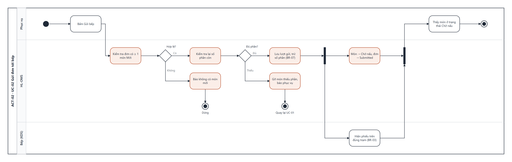

# UCS-02 — Gửi đơn tới bếp (Send Order to Kitchen)

| Mục | Nội dung |
|---|---|
| **Use Case ID** | UC-02 |
| **Use Case Name** | Gửi đơn tới bếp |
| **Actor** | Phục vụ (chính) · Bếp (nhận) |
| **Description** | Phục vụ gửi các món Mới của đơn tới bếp. Hệ thống chia món theo trạm, trừ số phần còn lại và hiện phiếu trên KDS của từng trạm |
| **Priority** | High |
| **Trigger** | Phục vụ chạm "Gửi bếp" trên SCR-05 |
| **Pre-condition** | 1. Đơn có ≥ 1 món Mới (UC-01). 2. Bàn Có khách, hoặc đơn mang về đã thanh toán (BR-02, BR-13) |
| **Post-condition** | Thành công: món chuyển **Chờ nấu**, đơn chuyển **Submitted** (hoặc giữ In Progress nếu gọi thêm), phiếu hiện trên đúng trạm ≤ 2 giây, số phần đã trừ. Thất bại: món giữ Mới |
| **Màn hình** | SCR-05 Đơn của bàn · SCR-07 KDS |
| **Truy vết** | US-07 · AC-07.1, AC-07.2, AC-07.3 |

## Basic Flow

| # | Actor | Hệ thống |
|---|---|---|
| 1 | Kiểm tra lại món với khách, chạm "Gửi bếp" | Kiểm tra đơn có ≥ 1 món Mới (BR-02) |
| 2 | — | Kiểm tra lại số phần còn của từng món (có thể đổi từ lúc thêm món) |
| 3 | — | Lưu lượt gửi kèm giờ gửi, trừ số phần (BR-07) |
| 4 | — | Song song: (a) chia món theo trạm (BR-03), hiện phiếu trên KDS kèm số bàn, giờ gửi, tùy chọn, ghi chú, dải đỏ dị ứng; (b) chuyển món → Chờ nấu, đơn → Submitted |
| 5 | Thấy các món chuyển nhãn "Chờ nấu" | Rung xác nhận, quay về SCR-02 |

## Alternative Flow

| ID | Điều kiện | Xử lý |
|---|---|---|
| AF-01 | Lượt gọi thêm | Phiếu trên KDS gắn nhãn "Gọi thêm" + số lượt; đơn giữ trạng thái hiện tại |
| AF-02 | Đơn chỉ có đồ uống | Chỉ trạm Quầy nước nhận phiếu |
| AF-03 | Đơn mang về | Phiếu gắn nhãn "Mang về" + mã TA-xx |

## Exception Flow

| ID | Điều kiện | Xử lý |
|---|---|---|
| EF-01 | Không có món Mới | Nút "Gửi bếp" bị tắt; nếu gọi qua API trả lỗi "Không có món mới" — dừng |
| EF-02 | Một món không còn đủ phần (bước 2) | Gỡ món đó khỏi lượt gửi, báo "Món X vừa hết", các món khác vẫn gửi; phục vụ quay lại UC-01 |
| EF-03 | Mất internet | Gửi qua mạng nội bộ tới KDS; đồng bộ lên máy chủ khi có mạng (UC-20) |
| EF-04 | KDS của trạm không phản hồi 10 giây | Tự in phiếu ra máy in dự phòng, cảnh báo Bếp trưởng (NFR-08) |

## Business Rules

BR-02 · BR-03 · BR-07 · BR-13.

## Non-Functional Requirements

NFR-01 (≤ 2 giây ở p95) · NFR-03 (60 đơn/giờ) · NFR-06 (offline ≥ 60 phút) · NFR-08 (in dự phòng).

## Activity Diagram

