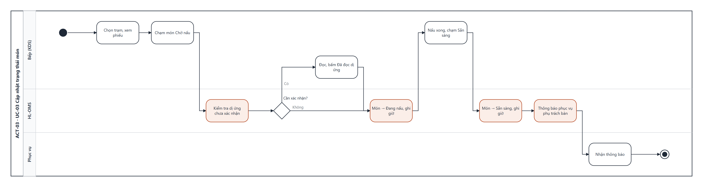

# UCS-03 — Cập nhật trạng thái món (Update Dish Status)

| Mục | Nội dung |
|---|---|
| **Use Case ID** | UC-03 |
| **Use Case Name** | Cập nhật trạng thái món |
| **Actor** | Bếp (chính) · Bếp trưởng · Đồng hồ hệ thống (phụ) |
| **Description** | Bếp xem phiếu của trạm theo thứ tự thời gian, xác nhận cảnh báo dị ứng, chuyển món Chờ nấu → Đang nấu → Sẵn sàng. Hệ thống đánh dấu món trễ và báo phục vụ khi món sẵn sàng |
| **Priority** | High |
| **Trigger** | Bếp chạm một món trên KDS (SCR-07) |
| **Pre-condition** | 1. Món đã gửi bếp, trạng thái Chờ nấu hoặc Đang nấu (UC-02). 2. KDS đã chọn trạm |
| **Post-condition** | Món ở trạng thái mới kèm thời điểm chuyển; món Sẵn sàng → phục vụ phụ trách bàn nhận thông báo (UC-09) |
| **Màn hình** | SCR-07 KDS · SCR-06 Thông báo (phía phục vụ) |
| **Truy vết** | US-15, US-16, US-17, US-18 · AC-15.1–15.2, AC-16.1–16.2, AC-17.1–17.2, AC-18.1 |

## Basic Flow

| # | Actor | Hệ thống |
|---|---|---|
| 1 | Chọn trạm (Bếp nóng · Bếp lạnh · Quầy nước) | Hiện phiếu của trạm, cũ nhất bên trái; mỗi phiếu có số bàn, giờ gửi, thời gian chờ, món, tùy chọn, ghi chú |
| 2 | Chạm món Chờ nấu | Kiểm tra món có dị ứng chưa xác nhận (BR-04) |
| 3 | — | Không có: món → **Đang nấu**, ghi giờ bắt đầu |
| 4 | Nấu xong, chạm món Đang nấu | Món → **Sẵn sàng**, ghi giờ |
| 5 | — | Gửi thông báo + rung tới điện thoại phục vụ phụ trách bàn (US-12) |
| 6 | — | Phiếu có mọi món Sẵn sàng chuyển xuống hàng "Chờ lấy"; khi phục vụ xác nhận hoặc bếp chạm "Đã lấy" → phiếu biến khỏi KDS |

## Alternative Flow

| ID | Điều kiện | Xử lý |
|---|---|---|
| AF-01 | Món có dị ứng chưa xác nhận (bước 2) | Hiện hộp đỏ liệt kê chất gây dị ứng; bếp chạm "Đã đọc dị ứng" → tiếp bước 3 |
| AF-02 | Chạm "Xong cả phiếu" | Mọi món Đang nấu của phiếu → Sẵn sàng cùng lúc |
| AF-03 | Bếp trưởng chạm giữ món đã chuyển nhầm | Trả món về trạng thái trước, ghi nhật ký (AC-17.2) |
| AF-04 | Thời gian chờ vượt ngưỡng trạm (Đồng hồ hệ thống) | Phiếu đổi cam; vượt 1,5 × ngưỡng đổi đỏ và đưa lên đầu (BR-06) |

## Exception Flow

| ID | Điều kiện | Xử lý |
|---|---|---|
| EF-01 | Món vừa bị hủy/chờ duyệt hủy (UC-08) | Món gạch ngang, nhãn "Đã hủy" / "Chờ duyệt hủy"; không chuyển trạng thái được |
| EF-02 | Thông báo tới phục vụ không được xử lý sau 2 phút | Nhắc lại; sau lần nhắc thứ 2 báo tới mọi phục vụ trong ca |
| EF-03 | KDS mất kết nối | Hiện banner đỏ; dùng máy in dự phòng (NFR-08) |

## Business Rules

BR-03 · BR-04 · BR-06 · BR-19.

## Non-Functional Requirements

NFR-01 · NFR-12 (chữ ≥ 24 px, nút ≥ 64 px, tương phản ≥ 4,5:1) · NFR-08.

## Activity Diagram

