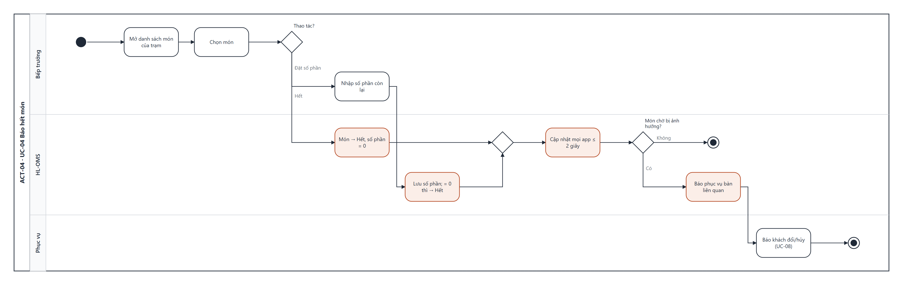

# UCS-04 — Báo hết món (Mark Dish Out of Stock)

| Mục | Nội dung |
|---|---|
| **Use Case ID** | UC-04 |
| **Use Case Name** | Báo hết món |
| **Actor** | Bếp trưởng (chính) · Quản lý |
| **Description** | Bếp trưởng đặt món sang Hết hoặc đặt số phần còn lại. Hệ thống chặn món trên mọi app gọi món và báo phục vụ của các bàn đang có món đó chờ nấu |
| **Priority** | High |
| **Trigger** | Bếp trưởng mở "Tình trạng món" trên SCR-08 và chọn một món |
| **Pre-condition** | Bếp trưởng đã đăng nhập trên KDS hoặc tablet |
| **Post-condition** | Món ở trạng thái Hết (hoặc có số phần còn lại); mọi app phục vụ hiện đúng trạng thái ≤ 2 giây; thao tác ghi nhật ký |
| **Màn hình** | SCR-08 Tổng hợp bếp & tình trạng món · SCR-03 (phía phục vụ) |
| **Truy vết** | US-20, US-14 · AC-20.1–20.3, AC-14.1–14.2 |

## Basic Flow

| # | Actor | Hệ thống |
|---|---|---|
| 1 | Mở "Tình trạng món", lọc theo trạm | Hiện danh sách món: trạng thái, số phần còn lại, số phần đang chờ |
| 2 | Chọn món → "Hết" | Món → Hết, số phần = 0 |
| 3 | — | Đẩy trạng thái tới mọi app ≤ 2 giây (BR-01) |
| 4 | — | Tìm món đó ở trạng thái Chờ nấu trong các đơn |
| 5 | — | Không có → kết thúc. Có → báo phục vụ phụ trách từng bàn: "Món X đã hết — bàn T05, T09" |
| 6 | Phục vụ báo khách đổi món hoặc hủy (→ UC-08) | — |

## Alternative Flow

| ID | Điều kiện | Xử lý |
|---|---|---|
| AF-01 | Chọn "Đặt số phần" (bước 2) | Nhập số phần còn lại (0–999); hệ thống lưu, về 0 thì tự chuyển Hết (BR-07); app phục vụ hiện "Còn n" khi n ≤ 3 |
| AF-02 | Chọn "Mở bán lại" | Món → Còn bán, bỏ giới hạn số phần hoặc nhập số mới; bỏ chặn trên mọi app |
| AF-03 | Đầu ca | Mọi món tự về Còn bán, không giới hạn (cấu hình của Quản lý) |

## Exception Flow

| ID | Điều kiện | Xử lý |
|---|---|---|
| EF-01 | Nhập số phần âm hoặc không phải số | Báo "Số phần không hợp lệ", không lưu |
| EF-02 | Đặt Hết khi món đang Đang nấu ở bàn khác | Món đang nấu không bị ảnh hưởng; chỉ chặn gọi mới |
| EF-03 | Mất internet | Trạng thái lan qua mạng nội bộ; đồng bộ lên máy chủ khi có mạng |

## Business Rules

BR-01 · BR-07 · BR-19.

## Non-Functional Requirements

NFR-01 (lan trạng thái ≤ 2 giây) · NFR-12 · NFR-06.

## Activity Diagram

