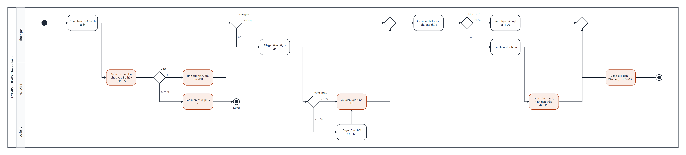

# UCS-05 — Thanh toán (Process Payment)

| Mục | Nội dung |
|---|---|
| **Use Case ID** | UC-05 |
| **Use Case Name** | Thanh toán |
| **Actor** | Thu ngân (chính) · Quản lý (duyệt) · Khách (phụ) |
| **Description** | Thu ngân mở bill của bàn, hệ thống tính tạm tính, giảm giá, phụ thu ngày lễ và GST; thu ngân ghi nhận thanh toán EFTPOS hoặc tiền mặt và in hóa đơn/tax invoice |
| **Priority** | High |
| **Trigger** | Khách xin tính tiền; thu ngân chọn bàn trên SCR-09 |
| **Pre-condition** | 1. Bàn có đơn. 2. Thu ngân đã đăng nhập. 3. Danh sách ngày lễ đã khai báo (UC-14) |
| **Post-condition** | Thành công: bill **Đã thanh toán**, đơn **Paid**, bàn **Cần dọn**, giao dịch vào báo cáo ca. Thất bại: bill giữ trạng thái trước |
| **Màn hình** | SCR-09 Thu ngân · SCR-11 Thanh toán & hóa đơn · SCR-14 Duyệt (phía Quản lý) |
| **Truy vết** | US-21, US-22, US-24 · AC-21.1–21.2, AC-22.1–22.2, AC-24.1–24.3 |

## Basic Flow

| # | Actor | Hệ thống |
|---|---|---|
| 1 | Chọn bàn trên SCR-09 | Kiểm tra mọi món Đã phục vụ hoặc Đã hủy, không còn yêu cầu chờ duyệt (BR-12) |
| 2 | — | Tính và hiện bill: món, số lượng, đơn giá, tùy chọn có phí, Tạm tính, Giảm giá, Phụ thu ngày lễ (BR-10), **Tổng**, "GST included" = Tổng ÷ 11 (BR-09) |
| 3 | In bill tạm, khách kiểm tra | Bill → **Đã in**, đơn → **Billed** |
| 4 | Khách xác nhận; chọn phương thức EFTPOS | Hiện số tiền cần quẹt |
| 5 | Quẹt trên máy EFTPOS độc lập, chạm "Đã thu EFTPOS" | Ghi nhận phương thức, số tiền, giờ |
| 6 | — | Bill → **Đã thanh toán**, đơn → **Paid**, bàn → **Cần dọn** (BR-17); in hóa đơn |

## Alternative Flow

| ID | Điều kiện | Xử lý |
|---|---|---|
| AF-01 | Tiền mặt (bước 4) | Làm tròn tổng tới 5 cent (BR-15); nhập tiền khách đưa → hiện tiền thừa; chạm "Đã thu" |
| AF-02 | Giảm giá ≤ 10% (trước bước 3) | Chọn % hoặc số tiền, cho cả bill hoặc từng món, chọn lý do → tính lại bill (BR-11) |
| AF-03 | Giảm giá > 10% hoặc miễn phí món | Gửi yêu cầu duyệt → Quản lý duyệt trên SCR-14 (UC-12) → áp vào bill; bill chờ tới khi có kết quả |
| AF-04 | Khách xin tax invoice (bước 6) | In tax invoice đủ trường BR-16; bill ≥ AUD 1.000 bắt buộc nhập tên/ABN người mua |
| AF-05 | Khách trả bằng hai phương thức | Nhập lần lượt từng phần; bill Đã thanh toán khi tổng đã thu = Tổng |
| AF-06 | Khách trả riêng | Chuyển sang UC-06 Tách bill |
| AF-07 | Ngày lễ | Dòng "Public holiday surcharge 15%" tự có ở bước 2 |

## Exception Flow

| ID | Điều kiện | Xử lý |
|---|---|---|
| EF-01 | Còn món chưa phục vụ hoặc chờ duyệt (bước 1) | Hiện danh sách món còn treo; không cho chốt (AC-21.2). Thu ngân có thể yêu cầu hủy món (UC-08) |
| EF-02 | Quản lý từ chối giảm giá | Bill giữ giá gốc, thu ngân nhận thông báo |
| EF-03 | Giao dịch EFTPOS bị từ chối | Không chạm "Đã thu"; chọn lại phương thức; bill giữ Đã in |
| EF-04 | Tiền khách đưa ít hơn tổng | Nút "Đã thu" tắt, báo "Còn thiếu AUD x" |
| EF-05 | Khách gọi thêm sau khi in bill | Bill → mở lại, đơn → In Progress; in lại bill sau khi món mới được phục vụ |
| EF-06 | Máy in hóa đơn lỗi | Lưu hóa đơn, cho in lại từ lịch sử; tùy chọn hiện mã QR hóa đơn để khách chụp |

## Business Rules

BR-09 · BR-10 · BR-11 · BR-12 · BR-15 · BR-16 · BR-17 · BR-19.

## Non-Functional Requirements

NFR-04 (mở bill ≤ 2 giây) · NFR-16 (nhật ký giảm giá) · NFR-22 (hóa đơn đúng quy định, lưu 5 năm).

## Activity Diagram

