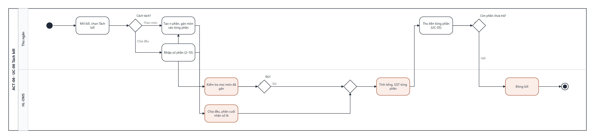

# UCS-06 — Tách bill (Split Bill)

| Mục | Nội dung |
|---|---|
| **Use Case ID** | UC-06 |
| **Use Case Name** | Tách bill |
| **Actor** | Thu ngân |
| **Description** | Thu ngân chia một bill thành nhiều phần để khách trả riêng, theo **một** trong hai cách: theo món hoặc chia đều. Mỗi phần có tổng và GST riêng, thanh toán độc lập |
| **Priority** | High |
| **Trigger** | Thu ngân chạm "Tách bill" trên SCR-11 |
| **Pre-condition** | Bill thỏa BR-12 (mọi món đã phục vụ/hủy), chưa có phần nào được thanh toán |
| **Post-condition** | Bill có n phần (2–10), tổng các phần = tổng bill; khi mọi phần đã thanh toán → bill Đã thanh toán |
| **Màn hình** | SCR-10 Tách bill · SCR-11 Thanh toán |
| **Truy vết** | US-23 · AC-23.1, AC-23.2, AC-23.3 |

## Basic Flow — tách theo món

| # | Actor | Hệ thống |
|---|---|---|
| 1 | Chạm "Tách bill" → "Theo món" | Hiện danh sách món bên trái, 2 phần trống bên phải |
| 2 | Chạm "+ Phần" nếu cần thêm (tối đa 10) | Thêm cột phần |
| 3 | Kéo hoặc chạm-chọn món vào từng phần; món số lượng > 1 tách được từng đơn vị | Cập nhật tạm tính từng phần |
| 4 | Chạm "Xác nhận" | Kiểm tra mọi món đã được gán (BR-14) |
| 5 | — | Tính cho từng phần: tạm tính, giảm giá phân bổ, phụ thu, tổng, GST |
| 6 | Thu tiền từng phần theo UC-05 bước 4–6 | Phần đã trả đánh dấu ✓ |
| 7 | — | Mọi phần đã trả → bill Đã thanh toán, bàn Cần dọn |

## Alternative Flow

| ID | Điều kiện | Xử lý |
|---|---|---|
| AF-01 | Chọn "Chia đều" (bước 1) | Nhập số phần 2–10 → tổng ÷ n làm tròn 2 chữ số, **phần cuối nhận số lẻ** để tổng khớp (VD 100,00 ÷ 3 = 33,33 · 33,33 · 33,34) |
| AF-02 | Giảm giá cả bill có trước khi tách | Phân bổ theo tỉ lệ giá trị từng phần |
| AF-03 | Một phần trả tiền mặt | Làm tròn 5 cent cho riêng phần đó (BR-15) |
| AF-04 | Hủy tách trước khi phần nào được trả | Bill trở về một phần duy nhất |

## Exception Flow

| ID | Điều kiện | Xử lý |
|---|---|---|
| EF-01 | Còn món chưa gán (bước 4) | Tô đỏ món chưa gán, báo "Còn 2 món chưa thuộc phần nào" |
| EF-02 | Đổi từ "Theo món" sang "Chia đều" khi đã gán món | Hỏi xác nhận, xóa cách tách cũ (BR-14: không trộn hai cách) |
| EF-03 | Số phần ngoài 2–10 | Báo "Số phần từ 2 đến 10" |
| EF-04 | Đã có phần được trả mà muốn tách lại | Không cho phép; chỉ Quản lý hủy giao dịch phần đã trả |

## Business Rules

BR-09 · BR-14 · BR-15.

## Non-Functional Requirements

NFR-04 · NFR-11 (thao tác chạm-chọn thay kéo thả trên màn nhỏ).

## Activity Diagram

