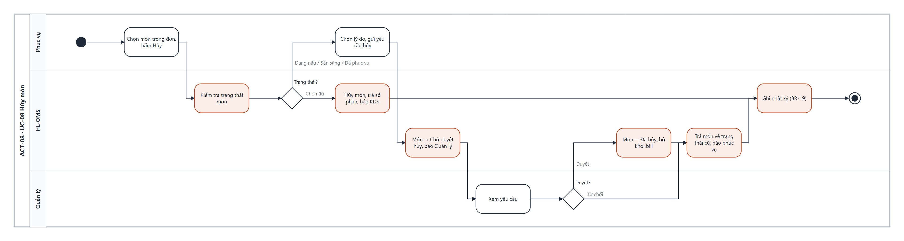

# UCS-08 — Hủy món (Cancel Order Item)

| Mục | Nội dung |
|---|---|
| **Use Case ID** | UC-08 |
| **Use Case Name** | Hủy món |
| **Actor** | Phục vụ (chính) · Thu ngân · Quản lý (duyệt) |
| **Description** | Phục vụ hủy món khi khách đổi ý hoặc món hết. Món chưa nấu hủy ngay; món đã bắt đầu nấu cần Quản lý duyệt kèm lý do để kiểm soát thất thoát |
| **Priority** | High |
| **Trigger** | Phục vụ chọn món trong SCR-05 và chạm "Hủy" |
| **Pre-condition** | Món đã gửi bếp (Chờ nấu, Đang nấu, Sẵn sàng hoặc Đã phục vụ) |
| **Post-condition** | Món **Đã hủy**, không tính vào bill, KDS cập nhật; hoặc món giữ trạng thái cũ khi bị từ chối. Mọi trường hợp ghi nhật ký |
| **Màn hình** | SCR-05 Đơn của bàn · SCR-14 Duyệt yêu cầu · SCR-07 KDS |
| **Truy vết** | US-09, US-10, US-29 · AC-09.1–09.2, AC-10.1–10.2, AC-29.1–29.2 |

## Basic Flow — món Chờ nấu

| # | Actor | Hệ thống |
|---|---|---|
| 1 | Chọn món, chạm "Hủy", chọn lý do (Khách đổi ý · Gọi nhầm · Hết món · Khác) | Kiểm tra trạng thái món (BR-05) |
| 2 | — | Món Chờ nấu → **Đã hủy** ngay, trả lại số phần (BR-07) |
| 3 | — | KDS gạch ngang món và gỡ khỏi phiếu sau 10 giây; ghi nhật ký (BR-19) |

## Alternative Flow

| ID | Điều kiện | Xử lý |
|---|---|---|
| AF-01 | Món Đang nấu / Sẵn sàng / Đã phục vụ (bước 1) | Bắt buộc chọn lý do → món → **Chờ duyệt hủy**, Quản lý nhận thông báo |
| AF-02 | Quản lý duyệt trên SCR-14 | Món → Đã hủy, không tính vào bill; phục vụ nhận thông báo "Đã duyệt hủy" |
| AF-03 | Quản lý từ chối | Món về trạng thái trước; phục vụ nhận thông báo kèm lý do từ chối |
| AF-04 | Hủy cả đơn khi chưa món nào Đang nấu | Mọi món → Đã hủy, đơn → **Cancelled**, bàn giữ Có khách (BR-20) |
| AF-05 | Đổi món | Hủy món cũ theo luồng trên, rồi gọi món mới (UC-01) |

## Exception Flow

| ID | Điều kiện | Xử lý |
|---|---|---|
| EF-01 | Không chọn lý do | Nút "Gửi" tắt |
| EF-02 | Quản lý không xử lý trong 5 phút | Nhắc lại Quản lý; bill của bàn không chốt được (BR-12) tới khi có kết quả |
| EF-03 | Món đã thuộc bill đã thanh toán | Không hủy được; Quản lý xử lý hoàn tiền ngoài phạm vi v1 |

## Business Rules

BR-05 (cổng OR) · BR-07 · BR-12 · BR-19 · BR-20.

## Non-Functional Requirements

NFR-14 (chỉ Quản lý duyệt) · NFR-16 (nhật ký 100% thao tác hủy).

## Activity Diagram

