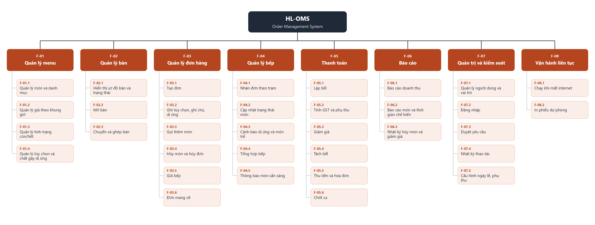

# Business Function Diagram và Function / Feature List — HL-OMS

| Mục | Nội dung |
|---|---|
| Function | Khả năng hệ thống phải có (hành vi + thông tin hệ thống quản lý) |
| Feature | Công cụ cụ thể trên giao diện giúp đạt function đó |
| Cách làm BFD | Xác định entity (HL-OMS) → chức năng cha → chức năng con |
| Sinh lại BFD | `python tools/build_bfd.py` (đọc bảng mục 2) |

## 1. Business Function Diagram

## 2. Function & Feature List

| ID | Function | Feature | UC | US | SCR |
|---|---|---|---|---|---|
| F-01 | **Quản lý menu** | | | | |
| F-01.1 | Quản lý món và danh mục | Form món song ngữ EN/VI · Danh mục sắp xếp thứ tự · Bật/tắt bán | UC-13 | US-26 | SCR-13 |
| F-01.2 | Quản lý giá theo khung giờ | Bảng giá Lunch Special (ngày, giờ, giá riêng) | UC-13 | US-27 | SCR-13, SCR-18 |
| F-01.3 | Quản lý tình trạng còn/hết | Nút Hết / Mở bán lại · Ô số phần còn lại · Nhãn "Còn n" · Món hết hiện mờ | UC-04 | US-20, US-14 | SCR-08, SCR-03 |
| F-01.4 | Quản lý tùy chọn và chất gây dị ứng | Nhóm tùy chọn bắt buộc/tùy ý có giá cộng thêm · Checklist 11 chất gây dị ứng · Trạm chế biến | UC-13 | US-26 | SCR-13 |
| F-02 | **Quản lý bàn** | | | | |
| F-02.1 | Hiển thị sơ đồ bàn và trạng thái | Sơ đồ theo khu · Màu theo trạng thái · Số khách, thời gian ngồi · Chuông món sẵn sàng | UC-07 | US-01 | SCR-02 |
| F-02.2 | Mở bàn | Hộp nhập số khách | UC-07 | US-02 | SCR-02 |
| F-02.3 | Chuyển và ghép bàn | Chọn bàn đích · Gộp đơn về bàn chính | UC-07 | US-03 | SCR-05 |
| F-03 | **Quản lý đơn hàng** | | | | |
| F-03.1 | Tạo đơn | Menu theo danh mục · Tìm kiếm không dấu · Chạm giữ để thêm nhanh | UC-01 | US-04 | SCR-03 |
| F-03.2 | Ghi tùy chọn, ghi chú, dị ứng | Bảng chi tiết món · Cảnh báo món chứa chất khách dị ứng | UC-01 | US-05, US-06 | SCR-04 |
| F-03.3 | Gọi thêm món | Lượt gọi thêm trên cùng đơn | UC-01 | US-08 | SCR-05 |
| F-03.4 | Hủy món và hủy đơn | Nút Hủy · Chọn lý do · Gửi yêu cầu duyệt | UC-08 | US-09, US-10 | SCR-05 |
| F-03.5 | Gửi bếp | Nút Gửi bếp · Định tuyến theo trạm · Trừ số phần | UC-02 | US-07 | SCR-05 |
| F-03.6 | Đơn mang về | Bàn ảo TA-xx · Thu tiền trước khi gửi bếp | UC-10 | US-11 | SCR-19 |
| F-04 | **Quản lý bếp** | | | | |
| F-04.1 | Nhận đơn theo trạm | KDS dạng cột phiếu · Bộ lọc trạm · Sắp theo giờ gửi | UC-03 | US-15 | SCR-07 |
| F-04.2 | Cập nhật trạng thái món | Chạm chuyển trạng thái · "Xong cả phiếu" · Hoàn tác (Bếp trưởng) | UC-03 | US-17 | SCR-07 |
| F-04.3 | Cảnh báo dị ứng và món trễ | Dải đỏ dị ứng · Nút "Đã đọc dị ứng" · Màu cam/đỏ theo ngưỡng trạm | UC-03 | US-16, US-18 | SCR-07 |
| F-04.4 | Tổng hợp bếp | Bảng số phần đang chờ theo món, theo trạm | UC-11 | US-19 | SCR-08 |
| F-04.5 | Thông báo món sẵn sàng | Thông báo + rung · Nhắc lại sau 2 phút · Nút "Đã lấy" / "Đã phục vụ" | UC-09 | US-12, US-13 | SCR-06, SCR-07 |
| F-05 | **Thanh toán** | | | | |
| F-05.1 | Lập bill | Bill chi tiết · In bill tạm | UC-05 | US-21 | SCR-09, SCR-11 |
| F-05.2 | Tính GST và phụ thu | Tự áp phụ thu ngày lễ · Dòng "GST included" | UC-05, UC-14 | US-21, US-28 | SCR-11 |
| F-05.3 | Giảm giá | Giảm % hoặc số tiền · Chọn lý do · Gửi duyệt khi vượt ngưỡng | UC-05 | US-22 | SCR-11 |
| F-05.4 | Tách bill | Tách theo món · Chia đều 2–10 phần | UC-06 | US-23 | SCR-10 |
| F-05.5 | Thu tiền và hóa đơn | EFTPOS / tiền mặt · Tiền thừa · Làm tròn 5 cent · Tax invoice | UC-05 | US-24 | SCR-11 |
| F-05.6 | Chốt ca | Doanh thu theo phương thức · Nhập tiền mặt đếm được · Lý do chênh lệch | UC-16 | US-25 | SCR-12 |
| F-06 | **Báo cáo** | | | | |
| F-06.1 | Báo cáo doanh thu | Lọc ngày/ca · Theo phương thức · GST, phụ thu, giảm giá · Xuất CSV | UC-15 | US-30 | SCR-15 |
| F-06.2 | Báo cáo món và thời gian chế biến | Top 10 món · Thời gian TB theo trạm | UC-15 | US-31 | SCR-15 |
| F-06.3 | Nhật ký hủy món và giảm giá | Danh sách lọc theo ngày, người | UC-15 | US-32 | SCR-15 |
| F-07 | **Quản trị và kiểm soát** | | | | |
| F-07.1 | Quản lý người dùng và vai trò | Tạo/khóa tài khoản · Gán 1 trong 6 vai trò · Đặt PIN | UC-17 | US-33 | SCR-16 |
| F-07.2 | Đăng nhập | Bàn phím PIN · Tự khóa sau 2 phút · Khóa sau 5 lần sai | UC-19 | US-33 | SCR-01 |
| F-07.3 | Duyệt yêu cầu | Hàng đợi yêu cầu hủy món, giảm giá · Duyệt / Từ chối | UC-12 | US-29 | SCR-14 |
| F-07.4 | Nhật ký thao tác | Lọc theo người, loại, thời gian · Chỉ xem | UC-18 | US-34 | SCR-17 |
| F-07.5 | Cấu hình ngày lễ, phụ thu | Lịch ngày lễ NSW · Mức % phụ thu · Câu thông báo trên menu | UC-14 | US-28 | SCR-18 |
| F-08 | **Vận hành liên tục** | | | | |
| F-08.1 | Chạy khi mất internet | Hub mạng nội bộ · Hàng đợi đồng bộ · Thanh trạng thái Offline | UC-20 | US-35 | SCR-02, SCR-07 |
| F-08.2 | In phiếu dự phòng | Nút "In phiếu" · Tự in khi KDS không phản hồi | UC-20 | US-35 | SCR-07 |

**Tổng:** 8 function cha, 34 function con.

## 3. Danh sách màn hình

| SCR | Màn hình | Ứng dụng | Thiết bị | Vai trò |
|---|---|---|---|---|
| SCR-01 | Đăng nhập PIN | Chung | Mọi thiết bị | Mọi vai trò |
| SCR-02 | Sơ đồ bàn | App Phục vụ | Điện thoại | Phục vụ |
| SCR-03 | Gọi món (menu) | App Phục vụ | Điện thoại | Phục vụ |
| SCR-04 | Chi tiết món | App Phục vụ | Điện thoại | Phục vụ |
| SCR-05 | Đơn của bàn | App Phục vụ | Điện thoại | Phục vụ |
| SCR-06 | Thông báo | App Phục vụ | Điện thoại | Phục vụ |
| SCR-07 | KDS theo trạm | Màn hình Bếp | Màn 22" / tablet | Bếp, Bếp trưởng |
| SCR-08 | Tổng hợp bếp và tình trạng món | Màn hình Bếp | Màn 22" / tablet | Bếp trưởng |
| SCR-09 | Bàn chờ thanh toán | Quầy Thu ngân | PC / tablet | Thu ngân |
| SCR-10 | Tách bill | Quầy Thu ngân | PC / tablet | Thu ngân |
| SCR-11 | Thanh toán và hóa đơn | Quầy Thu ngân | PC / tablet | Thu ngân |
| SCR-12 | Chốt ca | Quầy Thu ngân | PC / tablet | Thu ngân |
| SCR-13 | Quản lý menu | Trang Quản lý | PC / tablet | Quản lý |
| SCR-14 | Duyệt yêu cầu | Trang Quản lý | Điện thoại / PC | Quản lý |
| SCR-15 | Báo cáo | Trang Quản lý | PC | Quản lý |
| SCR-16 | Người dùng và phân quyền | Trang Quản lý | PC | Admin |
| SCR-17 | Nhật ký thao tác | Trang Quản lý | PC | Admin |
| SCR-18 | Cấu hình (ngày lễ, phụ thu, khung giờ) | Trang Quản lý | PC | Quản lý |
| SCR-19 | Đơn mang về | Quầy Thu ngân | PC / tablet | Thu ngân |

## 4. Dữ liệu mẫu

| File | Nội dung | Số dòng |
|---|---|---|
| [menu.csv](data/menu.csv) | 72 món: tên EN/VI, giá, giá Lunch Special, trạm, chất gây dị ứng, nhóm tùy chọn | 72 |
| [reference.csv](data/reference.csv) | Danh mục, trạm và ngưỡng trễ, 11 chất gây dị ứng, tùy chọn, khung giờ, phụ thu, lý do hủy/giảm giá | 37 |
| [tables.csv](data/tables.csv) | 22 bàn theo khu, số ghế | 22 |
| [users.csv](data/users.csv) | 16 tài khoản theo vai trò | 16 |
| [holidays.csv](data/holidays.csv) | Ngày lễ NSW 12/2026–12/2027, trạng thái xác nhận | 17 |

Ngày 26/04/2027 (thứ Hai sau Anzac Day) đang **To confirm**: LGNSW liệt kê, trang lịch của NSW Department of Education không có. Quản lý xác nhận trên trang chính thức của NSW Government trước 01/04/2027 (Q-041).
