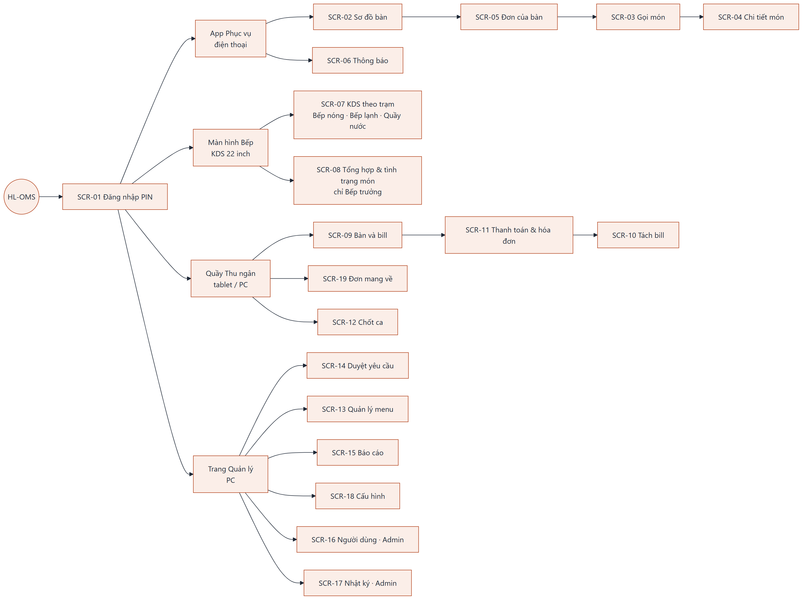
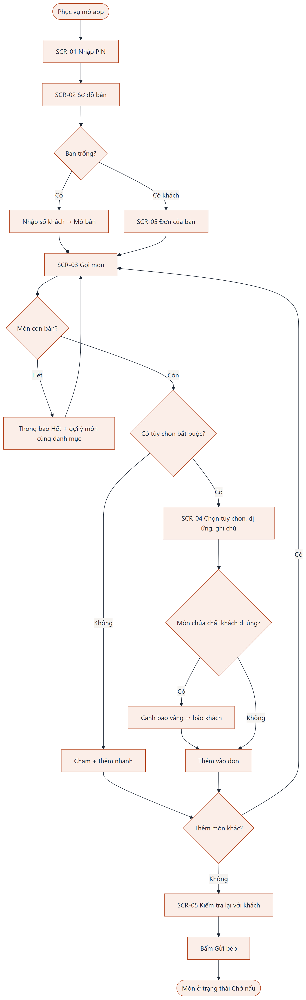
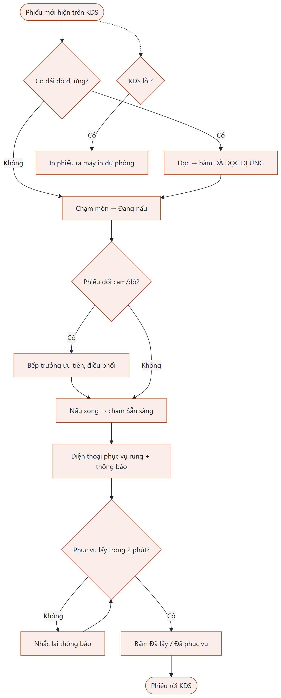
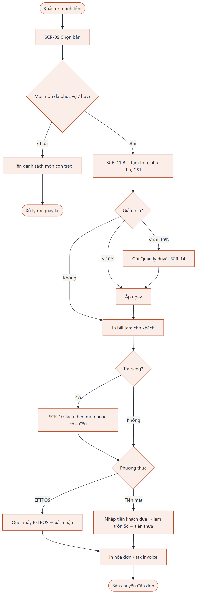

# Sitemap và User Flow — HL-OMS

Nguồn `.mmd` ở `diagrams/`, sinh lại: `python tools/mermaid.py 07_UIUX/diagrams`.

## 1. Sitemap

| Ứng dụng | Thiết bị | Người dùng | Màn hình | Điều hướng |
|---|---|---|---|---|
| App Phục vụ | Điện thoại Android 6" | Phục vụ | SCR-02 → SCR-05 → SCR-03 → SCR-04 · SCR-06 | Thanh tab dưới: Sơ đồ bàn · Thông báo · Khóa máy |
| Màn hình Bếp | Màn cảm ứng 22" (Bếp nóng, Bếp lạnh), tablet 10" (Quầy nước) | Bếp, Bếp trưởng | SCR-07 · SCR-08 | Tab trạm ở đầu màn hình; SCR-08 chỉ hiện với Bếp trưởng |
| Quầy Thu ngân | PC / tablet tại quầy | Thu ngân | SCR-09 → SCR-11 → SCR-10 · SCR-19 · SCR-12 | Tab ngang: Bàn và bill · Mang về · Chốt ca |
| Trang Quản lý | PC, mở được trên điện thoại | Quản lý, Admin | SCR-13 → SCR-18 | Menu bên trái, mục hiện theo vai trò |

Mọi ứng dụng vào qua SCR-01 Đăng nhập PIN.

## 2. User Flow

### UF-1 Gọi món (Phục vụ) — UC-01, UC-02

### UF-2 Bếp xử lý món — UC-03, UC-09

### UF-3 Thanh toán — UC-05, UC-06

| Flow | Số bước tối thiểu (happy case) | Mục tiêu UX |
|---|---|---|
| UF-1 | Mở bàn 2 chạm · món phổ biến 1 chạm · gửi bếp 1 chạm | NFR-10: ≤ 3 chạm thêm một món phổ biến |
| UF-2 | 2 chạm/món (Đang nấu, Sẵn sàng); 1 chạm cho cả phiếu | NFR-12: nút ≥ 64 px, dùng được khi tay ướt |
| UF-3 | Chọn bàn → Thanh toán → EFTPOS → xác nhận: 4 chạm | Bill đúng, ≤ 30 giây/bàn |
