# Wireframe / Prototype — HL-OMS

| Mục | Nội dung |
|---|---|
| Dạng | Prototype HTML click được, chạy trên trình duyệt (không cần cài đặt) — thay cho Balsamiq/Figma để demo được cả logic nghiệp vụ |
| Mở | Mở `prototype/index.html` bằng Chrome/Edge. Mở 2 tab cùng lúc (VD: Phục vụ và Bếp) để thấy đơn chạy thời gian thực |
| Đăng nhập | Chọn tên, PIN demo **1234** |
| Dữ liệu | `prototype/data.js` sinh từ [dữ liệu mẫu](../06_Function_Feature_State/data) (72 món, 22 bàn, 16 người dùng, ngày lễ NSW) bằng `python tools/build_proto_data.py` |
| Thanh mô phỏng | **Ngày lễ** (phụ thu 15%) · **Giờ trưa** (giá Lunch Special) · **Mất mạng** (chế độ offline) · **Kịch bản demo** · **Đặt lại** |
| Kiểm thử tự động | `python tools/test_prototype.py` chạy 18 bước kiểm theo BR và chụp lại ảnh các màn hình vào `screens/` |

Prototype thực thi đúng các quy tắc của SRS: BR-01, BR-04, BR-05, BR-06, BR-07, BR-08, BR-09, BR-10, BR-11, BR-12, BR-13, BR-14, BR-15, BR-17, BR-18, BR-19, BR-20, BR-21. Tích hợp phần cứng (máy in, rung, đồng bộ mạng nội bộ) được mô phỏng.

## Màn hình

### App Phục vụ

| SCR-01 Đăng nhập PIN | SCR-02 Sơ đồ bàn | SCR-03 Gọi món |
|---|---|---|
| 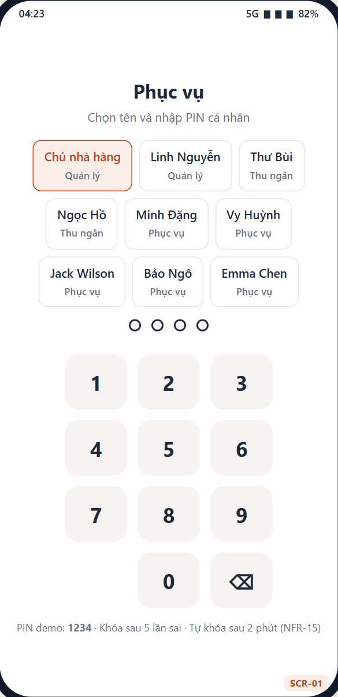 |  |  |
| Chọn tên + PIN 4 số; khóa sau 5 lần sai (NFR-15) | Màu theo trạng thái bàn; 🔔 khi có món sẵn sàng (US-01) | Danh mục, tìm không dấu, nhãn Hết/Còn n, nút + thêm nhanh (US-04, US-14) |

| SCR-04 Chi tiết món | SCR-05 Đơn của bàn | SCR-06 Thông báo |
|---|---|---|
|  | 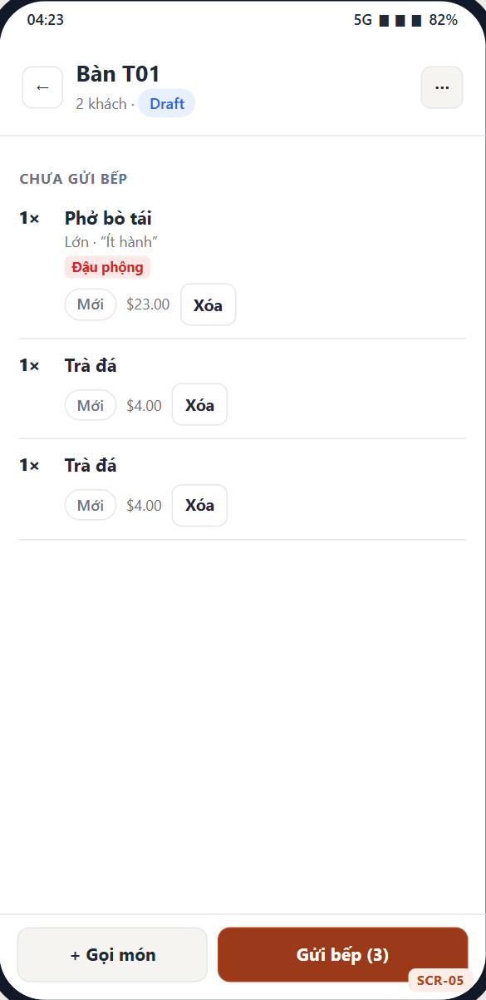 | 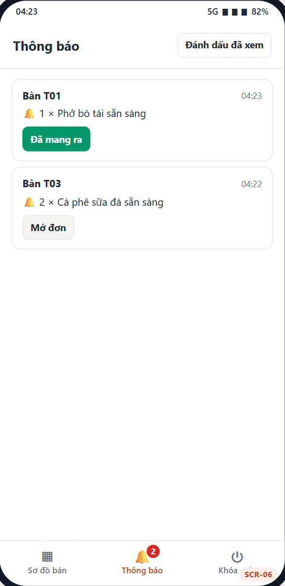 |
| Tùy chọn bắt buộc, 11 chất gây dị ứng, cảnh báo món chứa chất đó (US-05, US-06) | Món theo lượt gửi, trạng thái từng món, Gửi bếp, Hủy / Yêu cầu hủy (US-07→US-10) | Món sẵn sàng, món hết, kết quả duyệt (US-12, US-13) |

### Màn hình Bếp

| SCR-07 KDS theo trạm |
|---|
|  |
| Phiếu theo giờ gửi, viền cam/đỏ khi trễ (BR-06), dải đỏ dị ứng bắt buộc xác nhận (BR-04), Xong cả phiếu, Đã lấy, In phiếu dự phòng |

| SCR-08 Tổng hợp và tình trạng món |
|---|
| 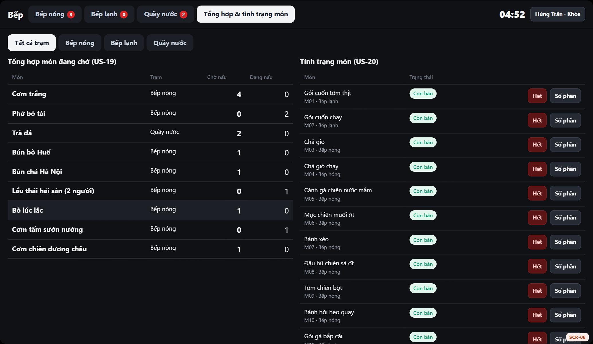 |
| Số phần đang chờ theo món (US-19); Hết · Số phần · Mở bán (US-20) |

### Quầy Thu ngân

| SCR-09 Bàn và bill | SCR-11 Thanh toán |
|---|---|
| 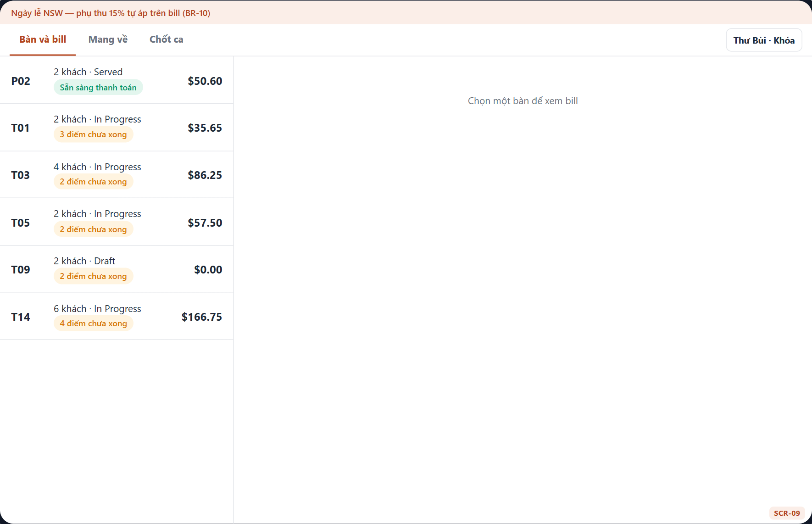 |  |
| Bill mở, số điểm chưa xong theo BR-12 | Tạm tính, giảm giá, phụ thu, Tổng, GST included (US-21, US-22) |

| SCR-10 Tách bill | Thu tiền mặt | Hóa đơn |
|---|---|---|
| 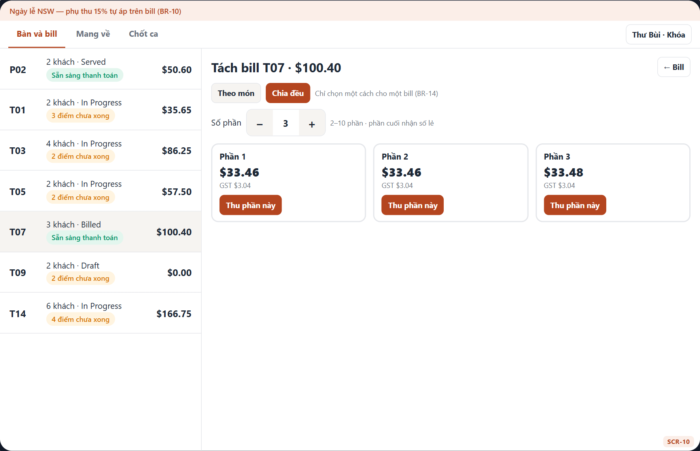 | 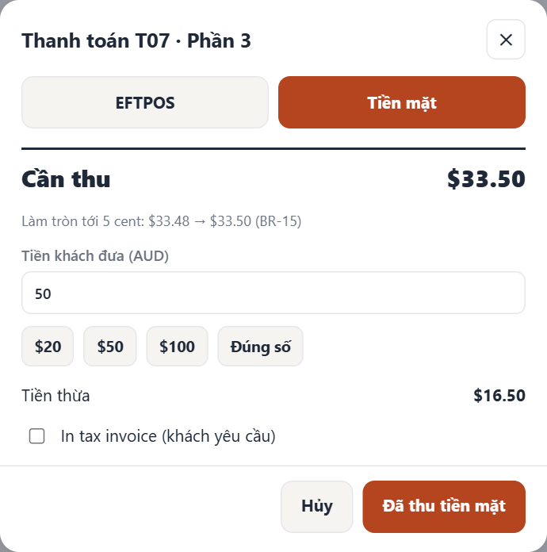 | 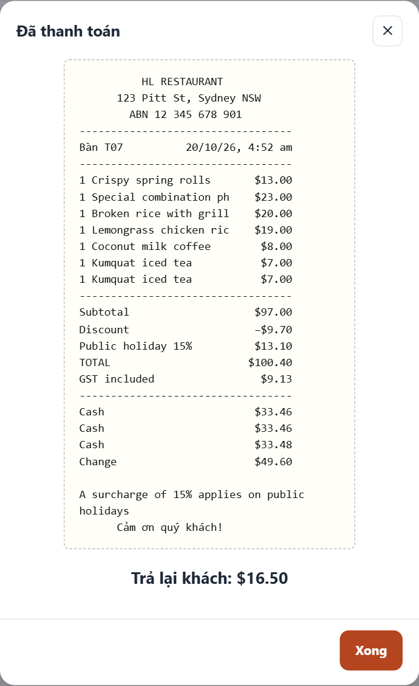 |
| Theo món XOR chia đều (BR-14) | Làm tròn 5 cent, tiền thừa (BR-15) | Hóa đơn / tax invoice (BR-16) |

| SCR-19 Đơn mang về | SCR-12 Chốt ca |
|---|---|
| 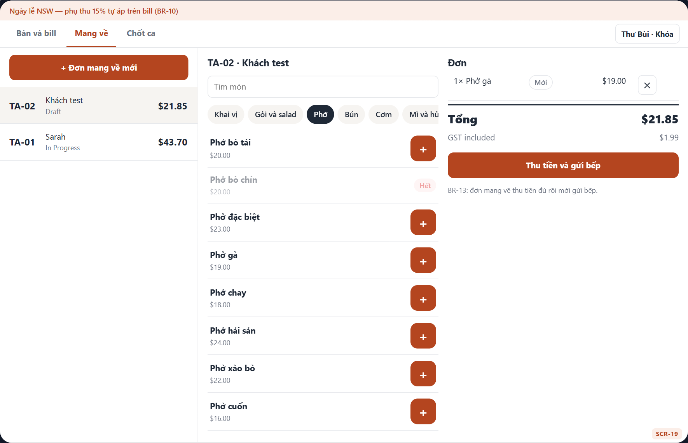 | 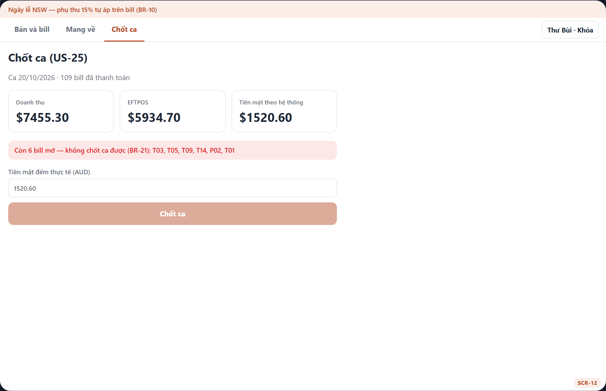 |
| Thu tiền trước, gửi bếp sau (BR-13) | Đối soát tiền mặt, chặn khi còn bill mở (BR-21) |

### Trang Quản lý

| SCR-14 Duyệt yêu cầu | SCR-13 Quản lý menu |
|---|---|
| 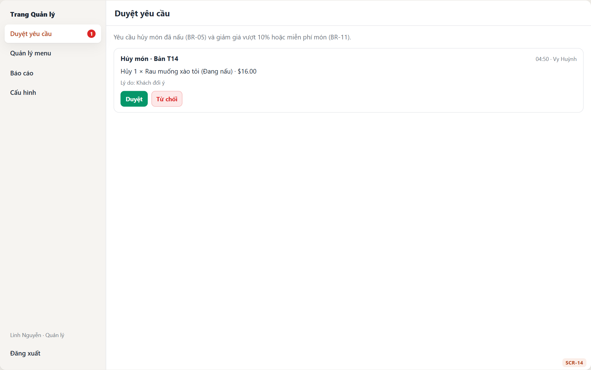 | 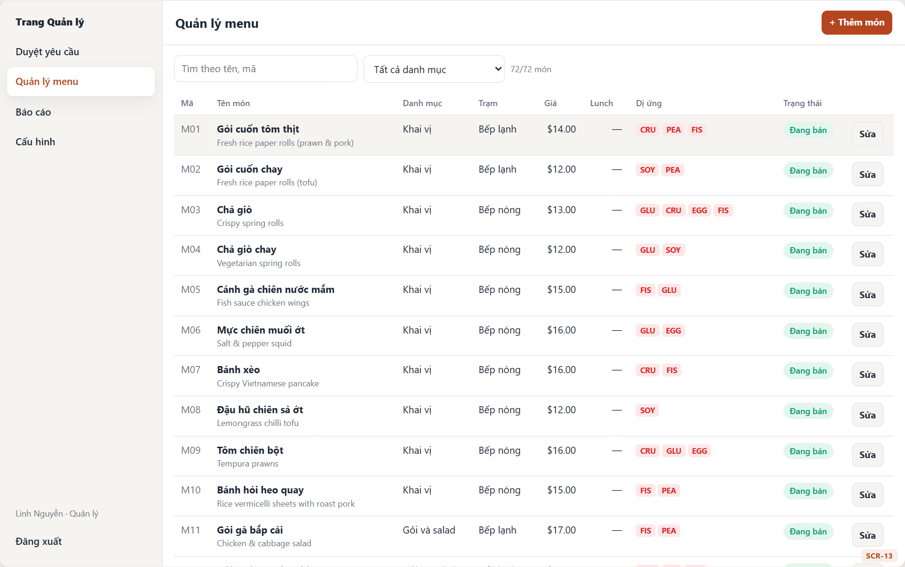 |
| Hủy món đã nấu, giảm giá > 10% (US-29) | 72 món, lọc, sửa giá/trạm/dị ứng (US-26) |

| SCR-15 Báo cáo | SCR-18 Cấu hình |
|---|---|
|  | 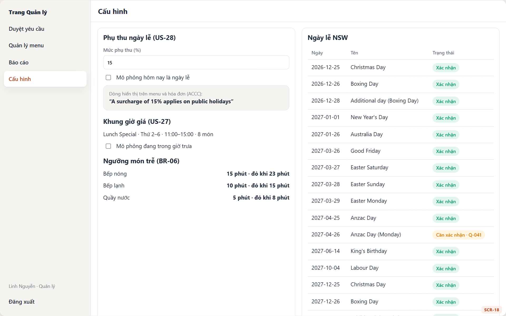 |
| Doanh thu, phương thức, top món, thời gian chế biến, xuất CSV (US-30→US-32) | Phụ thu, Lunch Special, ngưỡng trễ, ngày lễ NSW (US-27, US-28) |

| SCR-16 Người dùng | SCR-17 Nhật ký thao tác |
|---|---|
| 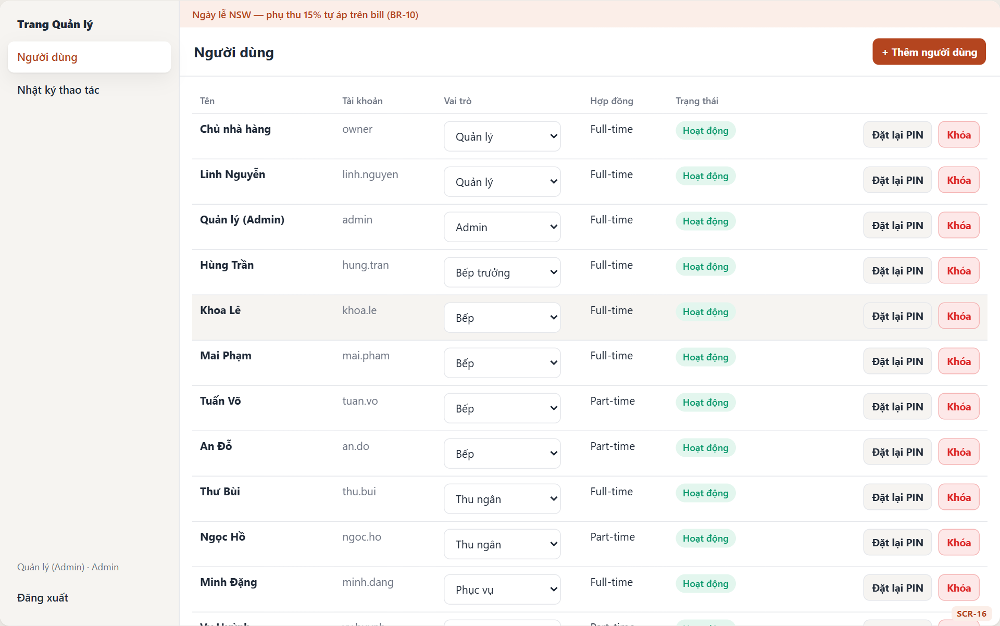 | 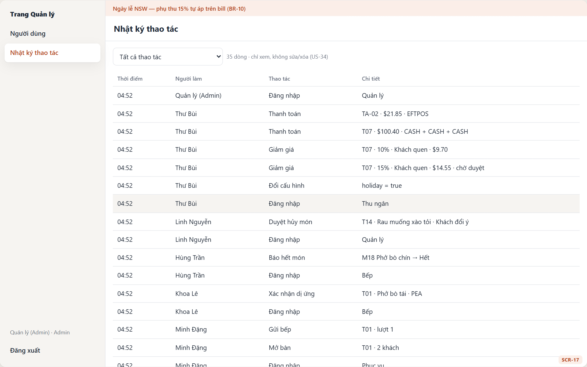 |
| Vai trò, khóa tài khoản, đặt lại PIN (US-33) | Chỉ xem, lọc theo thao tác (US-34) |
