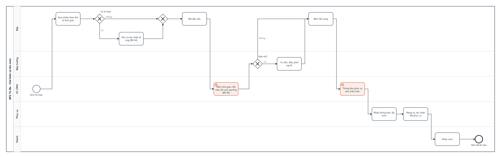
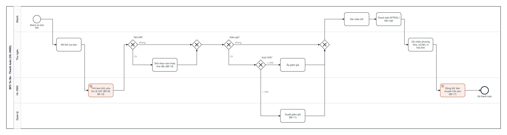

# Business Requirements Document — HL Restaurant Order Management System

| Mục | Nội dung |
|---|---|
| Dự án | HL-OMS |
| Khách hàng | HL Restaurant, Sydney CBD, NSW, Úc |
| Phiên bản | 1.0 — 27/11/2026 (baseline cuối Discovery) |
| Người lập | Business Analyst |
| Người duyệt | Chủ nhà hàng (Sponsor) · Quản lý nhà hàng (Product Owner) |
| Tài liệu liên quan | [SRS](SRS.md) · [UAT Test Cases](UAT-Test-Cases.md) · [RTM](RTM.md) |

## 1. Giới thiệu

### 1.1 Mục đích
Tài liệu xác định nhu cầu kinh doanh, phạm vi và yêu cầu nghiệp vụ của hệ thống quản lý gọi món HL-OMS, làm căn cứ để Chủ nhà hàng phê duyệt phạm vi, ngân sách và để đội dự án lập SRS.

### 1.2 Thuật ngữ

| Thuật ngữ | Nghĩa |
|---|---|
| OMS | Order Management System — hệ thống quản lý gọi món |
| KDS | Kitchen Display System — màn hình hiển thị món tại bếp |
| Trạm | Khu chế biến: Bếp nóng · Bếp lạnh · Quầy nước |
| GST | Goods and Services Tax 10% của Úc, đã gồm trong giá menu |
| Phụ thu ngày lễ | Khoản cộng thêm 15% vào bill trong ngày lễ chính thức NSW |
| Tax invoice | Hóa đơn thuế theo quy định ATO, in khi khách yêu cầu |
| EFTPOS | Thanh toán thẻ/ví điện thoại qua máy POS của ngân hàng |
| Lunch Special | Giá trưa 11:00–15:00, thứ 2–6 |
| Bàn ảo TA-xx | Mã đơn mang về |

## 2. Bối cảnh và vấn đề

HL Restaurant là nhà hàng Việt tại Sydney CBD, 22 bàn (~80 chỗ), mở cửa 11:00–22:30 hằng ngày, cao điểm tối thứ Sáu–thứ Bảy với đỉnh 45 đơn/giờ. Quy trình hiện tại dùng phiếu giấy 2 liên: phục vụ ghi và mang phiếu vào bếp, bếp gọi to khi món xong, thu ngân cộng bill bằng tay.

| Vấn đề | Bằng chứng (Discovery) | Hệ quả |
|---|---|---|
| Sai, sót món | 3–5 lần/ngày; 24 lần làm lại/tuần; 41/912 phiếu ghi tắt | ~AUD 900/tháng chi phí làm lại; 26% đánh giá xấu |
| Lên món chậm | Món đầu tiên sau TB 21–22 phút giờ cao điểm; phiếu chờ trên móc TB 3 phút | 42% đánh giá xấu nói về chờ lâu |
| Phục vụ chạy phiếu | ≈ 95 phút đi bộ/ca tối chỉ để đưa phiếu | Ít thời gian chăm khách |
| Bill sai | 1–2 lần/tuần; 2/50 hóa đơn ngày lễ thiếu phụ thu; 50/50 không ghi GST | Mất doanh thu, rủi ro tuân thủ |
| Hết món báo muộn | Khách biết sau 10–15 phút | Khách không hài lòng |
| Dị ứng | 2 sự cố suýt xảy ra/năm; ghi chú ở lề phiếu bị che | Rủi ro an toàn thực phẩm, pháp lý |

Nguồn: [MOM-01](../01_BACCM_Elicitation/Meeting-01/03_MOM-01-Bien-ban-hop.md), [Elicitation Results](../01_BACCM_Elicitation/04_Elicitation-Results.md), [BACCM](../01_BACCM_Elicitation/01_BACCM.md).

## 3. Mục tiêu kinh doanh

| ID | Nhu cầu | Baseline | Mục tiêu 6 tháng sau go-live | Cách đo |
|---|---|---|---|---|
| BN-01 | Giảm sai/sót món | 3–5 lần/ngày | ≤ 1 lần/ngày | Sổ làm lại món, nhật ký hủy "Gọi nhầm/Món lỗi" |
| BN-02 | Rút ngắn thời gian lên món | TB 22 phút | TB ≤ 15 phút | Báo cáo thời gian gửi → sẵn sàng → phục vụ |
| BN-03 | Bill chính xác, đúng GST và phụ thu | 1–2 lỗi/tuần | 0 | Khiếu nại bill, đối soát chốt ca |
| BN-04 | Kiểm soát hết món, hủy món, giảm giá | Không ghi nhận | 100% có lý do và người duyệt | Nhật ký thao tác |
| BN-05 | An toàn dị ứng | 2 sự cố suýt xảy ra/năm | 0; 100% món dị ứng được bếp xác nhận | Nhật ký "Xác nhận dị ứng" |
| BN-06 | Số liệu quản trị | Cộng sổ ~25 phút/ca | Báo cáo có ngay sau đóng ca | Báo cáo ngày |
| BN-07 | Tăng quay vòng bàn ca tối | — | +10% | Số lượt bàn ca tối T6–T7 |

## 4. Phạm vi

### 4.1 Trong phạm vi (MVP, go-live 01/03/2027)

| Business Case | Mô tả | Quy trình |
|---|---|---|
| BC-01 Gọi món tại bàn | Mở bàn, gọi món, tùy chọn, dị ứng, gửi bếp, gọi thêm, chuyển/ghép bàn | BP1 |
| BC-02 Gọi món mang về | Đơn tại quầy, thu tiền trước, gửi bếp | BP1 |
| BC-03 Chế biến và lên món | KDS theo trạm, trạng thái món, cảnh báo trễ, thông báo phục vụ | BP2 |
| BC-04 Hết món, đổi món, hủy món | Báo hết, chặn gọi, hủy có duyệt | BP4 |
| BC-05 Thanh toán | Bill, GST, phụ thu, giảm giá, tách bill, EFTPOS/tiền mặt, tax invoice | BP3 |
| BC-06 Cập nhật menu | Món, giá, Lunch Special, ngày lễ | BP5 |
| BC-07 Chốt ca và báo cáo | Đối soát tiền mặt, doanh thu, món bán chạy, thời gian chế biến, nhật ký | — |
| BC-08 Quản trị | Tài khoản, 6 vai trò, PIN, nhật ký thao tác | — |

### 4.2 Ngoài phạm vi

Khách tự gọi món qua QR · Đặt bàn online · Giao hàng qua ứng dụng · Tích hợp máy EFTPOS · Đồng bộ Xero · Quản lý kho nguyên liệu · Khách hàng thân thiết · Quản lý tip · Lưu dữ liệu cá nhân của khách. Năm hạng mục đầu nằm trong backlog V2 (US-36 → US-40).

## 5. Stakeholder

| Stakeholder | Vai trò | Quan tâm | RACI (duyệt BRD) |
|---|---|---|---|
| Chủ nhà hàng (BOM) | Sponsor, duyệt cuối | ROI, chi phí, doanh thu | A |
| Quản lý nhà hàng | Product Owner, Admin | Vận hành, báo cáo, kiểm soát | R |
| Bếp trưởng | Chuyên gia nghiệp vụ bếp | Đơn rõ ràng, điều phối, dị ứng | C |
| Bếp, Phục vụ, Thu ngân, Pha chế | Người dùng | Thao tác nhanh, ít nhầm | C |
| Kế toán thuê ngoài | Tư vấn GST, tax invoice | Hóa đơn đúng luật | C |
| Khách hàng | Bị tác động | Lên món nhanh, đúng, an toàn | I |
| Vendor (PM, BA, Dev, QA) | Đội dự án | Yêu cầu rõ, ổn định | R |

Chi tiết: [Stakeholder Analysis](../02_Initial_Analysis/02_Stakeholder-Analysis.md) · [RACI](../02_Initial_Analysis/04_RACI.md).

## 6. Quy trình nghiệp vụ

### 6.1 As-Is — Gọi món bằng phiếu giấy

### 6.2 To-Be — Gọi món trên HL-OMS

### 6.3 To-Be — Chế biến và lên món

### 6.4 To-Be — Thanh toán

Quy trình BP3 As-Is, BP4 (hết món, hủy món), BP5 (cập nhật menu) và mô tả từng bước: [Business Process Analysis](../04_Business_Process/01_Business-Process.md).

| Chỉ số | As-Is | To-Be |
|---|---|---|
| Đơn tới bếp | 5–10 phút | ≤ 2 giây |
| Đi bộ đưa phiếu/ca tối | ≈ 95 phút | 0 |
| Khách biết món hết | Sau 10–15 phút | Ngay lúc gọi |
| Cộng bill | 2–4 phút/bàn | ≤ 30 giây |
| Hóa đơn ghi GST | 0% | 100% |

## 7. Yêu cầu nghiệp vụ

Yêu cầu được viết dưới dạng User Story kèm Acceptance Criteria ([Product Backlog](../03_User_Story/01_Product-Backlog.md), [Story Map](../03_User_Story/02_User-Story-Map.md)). Bảng dưới tóm tắt theo Epic.

| Epic | Yêu cầu nghiệp vụ | User Story | Ưu tiên |
|---|---|---|---|
| EP-01 Quản lý bàn | Xem sơ đồ bàn theo trạng thái; mở bàn; chuyển, ghép bàn | US-01 → US-03 | Must/Should |
| EP-02 Gọi món | Chọn món theo danh mục/tìm kiếm; tùy chọn, ghi chú; khai báo dị ứng; gửi bếp; gọi thêm; sửa/hủy; mang về | US-04 → US-11 | Must |
| EP-03 Theo dõi phục vụ | Nhận thông báo món sẵn sàng; xác nhận đã phục vụ; biết món hết khi gọi | US-12 → US-14 | Must |
| EP-04 Chế biến | Xem đơn theo trạm, thứ tự; xác nhận dị ứng; cập nhật trạng thái; thấy món trễ | US-15 → US-18 | Must/Should |
| EP-05 Điều phối bếp | Tổng hợp món chờ; báo hết, đặt số phần | US-19, US-20 | Should/Must |
| EP-06 Thanh toán | Bill có GST, phụ thu; giảm giá; tách bill; thu tiền, hóa đơn; chốt ca | US-21 → US-25 | Must/Should |
| EP-07 Quản lý menu | Món, danh mục, tùy chọn, dị ứng, trạm; giá Lunch Special; ngày lễ, phụ thu | US-26 → US-28 | Must/Should |
| EP-08 Kiểm soát, báo cáo | Duyệt hủy/giảm giá; doanh thu, CSV; món bán chạy, thời gian chế biến; nhật ký | US-29 → US-32 | Must/Should |
| EP-09 Quản trị | Tài khoản, vai trò, PIN; nhật ký thao tác | US-33, US-34 | Must |
| EP-10 Vận hành liên tục | Tiếp tục làm việc khi mất internet; in phiếu dự phòng | US-35 | Must |

### 7.1 Quy tắc nghiệp vụ chính

| ID | Quy tắc |
|---|---|
| BR-01 | Chỉ gọi được món Còn bán AND còn phần |
| BR-04 | Chỉ bắt đầu nấu khi món không có dị ứng OR bếp đã xác nhận đọc dị ứng |
| BR-05 | Hủy món Đang nấu OR Sẵn sàng OR Đã phục vụ cần Quản lý duyệt |
| BR-09 | GST = Tổng ÷ 11 (giá đã gồm GST) |
| BR-10 | Ngày lễ NSW: phụ thu 15% × (Tạm tính − Giảm giá), ghi rõ trên menu và bill |
| BR-11 | Giảm > 10% OR miễn phí món cần Quản lý duyệt |
| BR-12 | Thanh toán khi mọi món Đã phục vụ/Đã hủy AND không còn chờ duyệt AND khách xác nhận bill |
| BR-13 | Đơn mang về thu tiền trước khi gửi bếp |
| BR-14 | Tách bill theo món XOR chia đều (2–10 phần), phần cuối nhận số lẻ |
| BR-15 | Tiền mặt làm tròn tới 5 cent gần nhất |
| BR-16 | Tax invoice đủ trường theo ATO khi khách yêu cầu |

Danh mục đầy đủ 21 quy tắc: [Business Rules](../05_Use_Case_Activity/02_Business-Rules.md).

### 7.2 Yêu cầu phi chức năng mức nghiệp vụ

| Nhóm | Yêu cầu |
|---|---|
| Hiệu năng | Đơn tới bếp ≤ 2 giây; chịu 60 đơn/giờ (1,3 × cao điểm) |
| Khả dụng | ≥ 99,5% trong giờ mở cửa; chạy tiếp ≥ 60 phút khi mất internet |
| Dễ dùng | Nhân viên mới thành thạo ≤ 30 phút; ≤ 3 chạm thêm món phổ biến; song ngữ EN/VI |
| Bảo mật | Phân quyền 6 vai trò; PIN cá nhân; nhật ký 100% thao tác nhạy cảm |
| Tuân thủ | GST, tax invoice (ATO); thông báo phụ thu (ACCC); thông tin dị ứng (FSANZ Std 1.2.3); dữ liệu lưu tại Úc (Privacy Act 1988) |

Chi tiết 23 NFR đo được: [NFR](../02_Initial_Analysis/05_NFR.md).

## 8. Giả định, ràng buộc, phụ thuộc

| Loại | Nội dung |
|---|---|
| Giả định | 25 giả định đã xác nhận ở MOM-01 ([Assumption Log](../00_Admin/Assumption-Log.md)) |
| Ràng buộc | Ngân sách phần mềm ≤ AUD 45.000 · Go-live 01/03/2027, không triển khai mùa Giáng sinh–Tết · Không có IT nội bộ |
| Phụ thuộc | Phần cứng (5 điện thoại, 2 KDS, 1 tablet, máy in nhiệt) mua trước 15/02/2027 · Wi-Fi tách SSID cho thiết bị OMS · Kế toán xác nhận mẫu hóa đơn (đã xong 09/11/2026) |
| Câu hỏi mở | Q-041: 26/04/2027 có là ngày lễ NSW — Quản lý xác nhận trước 01/04/2027 |

## 9. Rủi ro chính

| ID | Rủi ro | Mức | Ứng phó |
|---|---|---|---|
| RK-01 | Mất internet giờ cao điểm | Cao | Hub mạng nội bộ, in phiếu dự phòng |
| RK-02 | Nhân viên phản đối thay đổi | TB | User testing, chạy song song phiếu giấy 1 tuần, đào tạo ≤ 30 phút |
| RK-04 | Sót cảnh báo dị ứng | TB | Bắt buộc xác nhận trên KDS, TC High trong UAT |
| RK-10 | Dữ liệu menu sai | TB | Bếp trưởng rà 72 món trước go-live |

Đầy đủ 14 rủi ro: [Risk Register](../02_Initial_Analysis/03_Risk-Register.md).

## 10. Lợi ích và chi phí

| Khoản | Năm 1 |
|---|---|
| Chi phí phần mềm (triển khai) | AUD 42.000 |
| Phần cứng | AUD 4.500 |
| Thuê bao + hỗ trợ (từ tháng 4) | AUD 2.700 |
| **Tổng chi phí năm 1** | **AUD 49.200** |
| Lợi ích ước tính/năm | AUD 40.700 khi đạt mục tiêu (năm 1 tính 80%): giảm làm lại món, giảm thất thoát bill, tăng lượt bàn ca tối, rút ngắn chốt ca |
| Hoàn vốn · NPV 3 năm (8%) | ~18 tháng · AUD 45.900 |

Chi tiết và giả định tính toán: [Business Case](../09_Pitching/Business-Case.md).

## 11. Phê duyệt

| Vai trò | Họ tên | Quyết định | Ngày |
|---|---|---|---|
| Chủ nhà hàng (Sponsor) | — | Phê duyệt | 27/11/2026 |
| Quản lý nhà hàng (PO) | — | Phê duyệt | 27/11/2026 |
| Project Manager (vendor) | — | Xác nhận | 27/11/2026 |
