# Software Requirements Specification — HL Restaurant Order Management System

| Mục | Nội dung |
|---|---|
| Dự án | HL-OMS |
| Phiên bản | 1.1 — 26/02/2027 (baseline 1.0 ngày 27/11/2026; bổ sung truy vết sau UAT) |
| Người lập | Business Analyst |
| Người duyệt | Product Owner (Quản lý nhà hàng) · Project Manager |
| Căn cứ | [BRD 1.0](BRD.md) |
| Truy vết | [RTM](RTM.md) — 35/35 User Story MVP, 73/73 AC, 65/65 luồng UCS có Test Case |

> Bản Markdown liên kết tới tài liệu chi tiết; bản Word (`HL-OMS_SRS.docx`) gộp đầy đủ nội dung các liên kết có đánh dấu "gộp".

## 1. Giới thiệu

### 1.1 Mục đích
SRS đặc tả hành vi của HL-OMS ở mức hệ thống — use case, quy tắc, dữ liệu, giao diện, yêu cầu phi chức năng — để Dev Team xây dựng và QA kiểm thử. Thuật ngữ dùng chung với BRD §1.2.

### 1.2 Phạm vi
Bốn ứng dụng trên một nền tảng web (PWA): **App Phục vụ** · **Màn hình Bếp (KDS)** · **Quầy Thu ngân** · **Trang Quản lý**. Phạm vi MVP gồm 35 User Story (BRD §4.1).

## 2. Tổng quan hệ thống

### 2.1 Sơ đồ ngữ cảnh

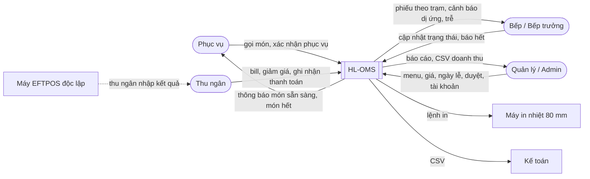

### 2.2 Kiến trúc mức cao

| Thành phần | Mô tả | NFR |
|---|---|---|
| Ứng dụng web (PWA) | Một ứng dụng, 4 giao diện theo vai trò; chạy trên Chrome Android, màn cảm ứng, PC | NFR-23 |
| Máy chủ cloud | Region Úc; lưu dữ liệu, báo cáo, sao lưu liên tục | NFR-05, NFR-07, NFR-17 |
| Hub mạng nội bộ | Thiết bị nhỏ tại nhà hàng, chuyển tiếp đơn giữa các máy khi mất internet, đồng bộ lại khi có mạng | NFR-06 |
| Máy in nhiệt | In phiếu bếp dự phòng, bill, hóa đơn qua mạng LAN | NFR-08 |
| Thiết bị | 5 điện thoại phục vụ · 2 KDS 22" · 1 tablet Quầy nước · PC quầy thu ngân | MOM-01 §3.3 |

### 2.3 Actor và vai trò

| Vai trò | Ứng dụng | Mô tả |
|---|---|---|
| Phục vụ | App Phục vụ | Mở bàn, gọi món, gửi bếp, hủy món, nhận thông báo |
| Bếp | Màn hình Bếp | Xem phiếu theo trạm, cập nhật trạng thái, xác nhận dị ứng |
| Bếp trưởng | Màn hình Bếp | Như Bếp + tổng hợp, báo hết món, hoàn tác |
| Thu ngân | Quầy Thu ngân (+ App Phục vụ) | Bill, giảm giá ≤ 10%, tách bill, thu tiền, mang về, chốt ca |
| Quản lý | Mọi ứng dụng trừ mục Admin | Duyệt, menu, cấu hình, báo cáo |
| Admin | Trang Quản lý | Tài khoản, vai trò, nhật ký thao tác |

### 2.4 Sitemap

## 3. Yêu cầu chức năng

### 3.1 Business Function Diagram

Danh sách 34 function con, feature, UC, US, màn hình: [Function & Feature List](../06_Function_Feature_State/01_Function-Feature-List.md).

### 3.2 Use Case

Danh sách 20 Use Case và phân rã cấp 3: [Use Case Diagram](../05_Use_Case_Activity/01_Use-Case-Diagram.md).

### 3.3 Use Case Specification chi tiết

- [UCS-01 Tạo đơn](../05_Use_Case_Activity/03_UCS/UCS-01_Tao-don.md) <!-- include: ../05_Use_Case_Activity/03_UCS/UCS-01_Tao-don.md -->
- [UCS-02 Gửi đơn tới bếp](../05_Use_Case_Activity/03_UCS/UCS-02_Gui-don-toi-bep.md) <!-- include: ../05_Use_Case_Activity/03_UCS/UCS-02_Gui-don-toi-bep.md -->
- [UCS-03 Cập nhật trạng thái món](../05_Use_Case_Activity/03_UCS/UCS-03_Cap-nhat-trang-thai-mon.md) <!-- include: ../05_Use_Case_Activity/03_UCS/UCS-03_Cap-nhat-trang-thai-mon.md -->
- [UCS-04 Báo hết món](../05_Use_Case_Activity/03_UCS/UCS-04_Bao-het-mon.md) <!-- include: ../05_Use_Case_Activity/03_UCS/UCS-04_Bao-het-mon.md -->
- [UCS-05 Thanh toán](../05_Use_Case_Activity/03_UCS/UCS-05_Thanh-toan.md) <!-- include: ../05_Use_Case_Activity/03_UCS/UCS-05_Thanh-toan.md -->
- [UCS-06 Tách bill](../05_Use_Case_Activity/03_UCS/UCS-06_Tach-bill.md) <!-- include: ../05_Use_Case_Activity/03_UCS/UCS-06_Tach-bill.md -->
- [UCS-08 Hủy món](../05_Use_Case_Activity/03_UCS/UCS-08_Huy-mon.md) <!-- include: ../05_Use_Case_Activity/03_UCS/UCS-08_Huy-mon.md -->

### 3.4 Đặc tả rút gọn các Use Case còn lại

| UC | Actor | Mô tả | Tiền điều kiện | Luồng chính | Ngoại lệ chính | BR | SCR |
|---|---|---|---|---|---|---|---|
| UC-07 Quản lý bàn | Phục vụ | Mở bàn, chuyển bàn, ghép bàn, xác nhận đã dọn | Đăng nhập | Chạm bàn Trống → số khách → Mở; ⋯ → Chuyển/Ghép; bàn Cần dọn → Đã dọn | Bàn đích không Trống → không cho chọn | BR-17, BR-18, BR-19 | SCR-02, SCR-05 |
| UC-09 Nhận thông báo, phục vụ món | Phục vụ | Nhận thông báo món sẵn sàng và xác nhận đã mang ra | Món Sẵn sàng | Rung + thông báo → lấy món → "Đã mang ra" | Không xử lý 2 phút → nhắc lại, lần 2 báo cả ca | — | SCR-06, SCR-05 |
| UC-10 Tạo đơn mang về | Thu ngân | Đơn mang về tại quầy | Đăng nhập | Đơn mới TA-xx → tên khách → chọn món → thu tiền → hệ thống gửi bếp | Thanh toán thất bại → không gửi bếp | BR-13 | SCR-19 |
| UC-11 Xem tổng hợp bếp | Bếp trưởng | Số phần đang chờ theo món, theo trạm | — | Mở Tổng hợp → lọc trạm | — | — | SCR-08 |
| UC-12 Duyệt yêu cầu | Quản lý | Duyệt/từ chối hủy món đã nấu, giảm giá vượt ngưỡng | Có yêu cầu chờ | Xem yêu cầu → Duyệt/Từ chối → người gửi nhận thông báo | Không xử lý 5 phút → nhắc lại | BR-05, BR-11, BR-19 | SCR-14 |
| UC-13 Quản lý menu | Quản lý | Thêm/sửa món, danh mục, giá, Lunch Special, tùy chọn, dị ứng, trạm, ngừng bán | — | Mở menu → Thêm/Sửa → Lưu → đẩy tới mọi app | Thiếu tên EN/VI, giá ≤ 0 → báo lỗi | BR-03, BR-08, BR-19 | SCR-13 |
| UC-14 Thiết lập ngày lễ, phụ thu | Quản lý | Lịch ngày lễ NSW, mức phụ thu, câu thông báo | — | Thêm/xác nhận ngày lễ → đặt mức % → lưu | Ngày trùng → không thêm | BR-10 | SCR-18 |
| UC-15 Xem báo cáo | Quản lý | Doanh thu, phương thức, món bán chạy, thời gian chế biến, nhật ký hủy/giảm giá, CSV | — | Chọn ngày/ca → xem → Xuất CSV | Không có dữ liệu → hiện trống | — | SCR-15 |
| UC-16 Chốt ca | Thu ngân | Đối soát tiền mặt cuối ca | Không còn bill mở | Xem doanh thu theo phương thức → nhập tiền mặt đếm được → Chốt | Chênh > AUD 5 → bắt buộc lý do; còn bill mở → chặn | BR-21 | SCR-12 |
| UC-17 Quản lý tài khoản, vai trò | Admin | Tạo/khóa tài khoản, gán vai trò, đặt PIN | — | Thêm → họ tên, tài khoản, vai trò, PIN → Lưu | PIN không 4–6 số, tài khoản trùng → báo lỗi | BR-19 | SCR-16 |
| UC-18 Xem nhật ký thao tác | Admin | Tra cứu ai làm gì, khi nào | — | Lọc theo người, thao tác, thời gian | — | BR-19 | SCR-17 |
| UC-19 Đăng nhập bằng PIN | Mọi actor | Đăng nhập nhanh trên thiết bị dùng chung | Tài khoản hoạt động | Chọn tên → nhập PIN → vào ứng dụng theo vai trò | Sai 5 lần → khóa; 2 phút không thao tác → tự khóa | — | SCR-01 |
| UC-20 Vận hành khi mất mạng | Phục vụ, Bếp | Gọi món, KDS, thông báo chạy qua hub nội bộ | Mất internet | Banner Offline → thao tác bình thường → có mạng → đồng bộ | KDS lỗi → in phiếu dự phòng | — | Mọi màn hình |

## 4. Business Rules

Danh mục 21 quy tắc kèm cổng logic AND/OR/XOR và ví dụ tính bill: [Business Rules](../05_Use_Case_Activity/02_Business-Rules.md) <!-- include: ../05_Use_Case_Activity/02_Business-Rules.md -->

## 5. Phân quyền

| Function | Phục vụ | Bếp | Bếp trưởng | Thu ngân | Quản lý | Admin |
|---|:-:|:-:|:-:|:-:|:-:|:-:|
| F-01.1 Món, danh mục · F-01.2 Giá khung giờ · F-01.4 Tùy chọn, dị ứng | | | Xem | | ✓ | |
| F-01.3 Tình trạng còn/hết | Xem | Xem | ✓ | Xem | ✓ | |
| F-02 Quản lý bàn | ✓ | | | ✓ | ✓ | |
| F-03.1–F-03.3 Tạo đơn, tùy chọn, gọi thêm | ✓ | | | ✓ | ✓ | |
| F-03.4 Hủy món Chờ nấu | ✓ | | | ✓ | ✓ | |
| F-03.4 Yêu cầu hủy món đã nấu | ✓ | | | ✓ | ✓ | |
| F-03.5 Gửi bếp | ✓ | | | ✓ | ✓ | |
| F-03.6 Đơn mang về | | | | ✓ | ✓ | |
| F-04.1–F-04.3 KDS, trạng thái, cảnh báo | | ✓ | ✓ | | ✓ | |
| F-04.2 Hoàn tác trạng thái | | | ✓ | | ✓ | |
| F-04.4 Tổng hợp bếp | | | ✓ | | ✓ | |
| F-04.5 Nhận thông báo món sẵn sàng | ✓ | | | ✓ (mang về) | | |
| F-05.1, F-05.2, F-05.4, F-05.5 Bill, tách bill, thu tiền | | | | ✓ | ✓ | |
| F-05.3 Giảm giá ≤ 10% | | | | ✓ | ✓ | |
| F-05.6 Chốt ca | | | | ✓ | ✓ | |
| F-06 Báo cáo | | | | | ✓ | |
| F-07.3 Duyệt yêu cầu | | | | | ✓ | |
| F-07.5 Ngày lễ, phụ thu | | | | | ✓ | |
| F-07.1 Người dùng, vai trò · F-07.4 Nhật ký | | | | | | ✓ |
| F-07.2 Đăng nhập · F-08 Vận hành liên tục | ✓ | ✓ | ✓ | ✓ | ✓ | ✓ |

## 6. Trạng thái đối tượng

| Đối tượng | Trạng thái | Sơ đồ |
|---|---|---|
| Order | Draft → Submitted → In Progress → Served → Billed → Paid · Cancelled |  |
| Order Item | New → Queued → Cooking → Ready → Served · Void Pending → Cancelled |  |
| Table | Available → Occupied → Awaiting Payment → Cleaning · Merged | 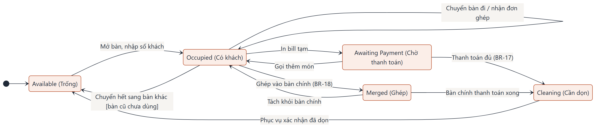 |
| Bill | Open → Pending Approval → Printed → Split → Partially Paid → Paid | 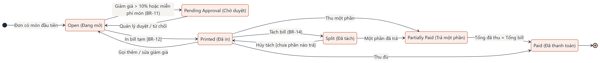 |
| Menu Item | Available ↔ Limited ↔ Sold Out · Inactive | 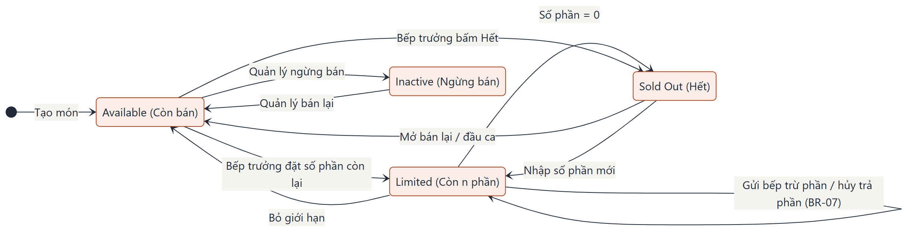 |

Bảng chuyển trạng thái (sự kiện, điều kiện, hành động): [State Machine](../06_Function_Feature_State/02_State-Machine.md).

## 7. Dữ liệu

### 7.1 Mô hình dữ liệu khái niệm

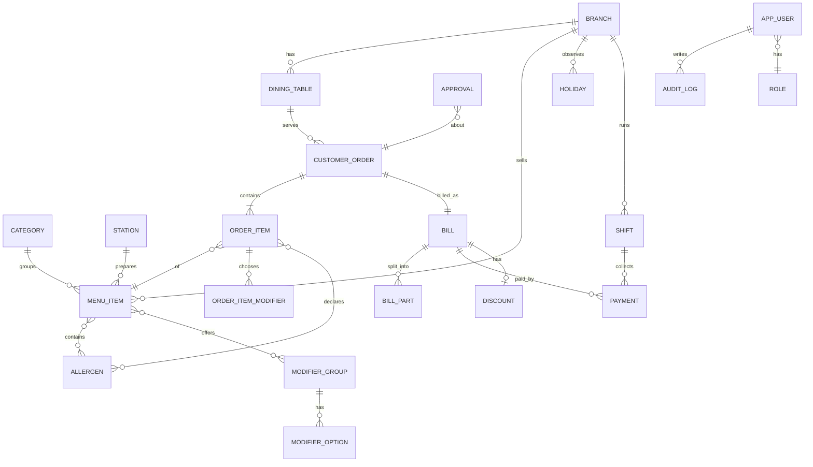

### 7.2 Từ điển dữ liệu (thuộc tính chính)

| Thực thể | Thuộc tính | Quy tắc |
|---|---|---|
| BRANCH | branch_id, tên, ABN, địa chỉ, múi giờ (Australia/Sydney) | Mọi bảng mang branch_id (NFR-21) |
| DINING_TABLE | table_code (T01–T18, P01–P04, TA-xx), khu, số ghế, trạng thái, waiter_id, merged_into | Trạng thái theo SM Table |
| MENU_ITEM | item_id (M01–M72), tên VI, tên EN, category_id, station_id, giá (AUD, gồm GST), giá Lunch, tình trạng, số phần còn | Giá > 0; tên VI và EN bắt buộc |
| ALLERGEN | code (GLU, CRU, EGG, FIS, MLK, PEA, TRN, SES, SOY, SUL, LUP), tên | 11 nhóm theo FSANZ Std 1.2.3 |
| MODIFIER_GROUP / OPTION | group_code (SPICE, SIZE, TOPPING), bắt buộc?, option, giá cộng | Nhóm bắt buộc phải chọn 1 |
| CUSTOMER_ORDER | order_id, table_code, loại (DINE/TA), trạng thái, số lượt gửi, tên khách (TA), created_at | Trạng thái suy ra từ ORDER_ITEM |
| ORDER_ITEM | item_line_id, order_id, item_id, số lượng, đơn giá tại thời điểm thêm, ghi chú (≤ 100 ký tự), lượt, trạng thái, sent_at, cooking_at, ready_at, served_at, đã đọc dị ứng | Đơn giá cố định sau khi thêm (BR-08) |
| BILL | bill_id, order_id, tạm tính, giảm giá, phụ thu, tổng, GST, trạng thái | GST = Tổng ÷ 11; tiền lưu theo cent |
| BILL_PART | part_no, cách tách (ITEM/EQUAL), số tiền, đã trả | Tổng các phần = tổng bill (BR-14) |
| PAYMENT | payment_id, bill_id, part_no, phương thức (EFTPOS/CASH), số tiền, tiền khách đưa, tiền thừa, shift_id, paid_at | Lưu ≥ 5 năm (NFR-22) |
| DISCOUNT | loại (PCT/AMT/FREE), giá trị, lý do, trạng thái (APPLIED/PENDING/REJECTED) | BR-11 |
| APPROVAL | approval_id, loại (VOID/DISCOUNT), đối tượng, lý do, người gửi, người duyệt, kết quả, thời điểm | BR-05, BR-11 |
| APP_USER / ROLE | username, họ tên, role, PIN (băm), trạng thái, số lần sai | PIN 4–6 số, không trùng (NFR-15) |
| HOLIDAY | ngày, tên, trạng thái xác nhận, nguồn | Dùng cho BR-10 |
| SHIFT | shift_id, mở lúc, đóng lúc, người chốt, tiền mặt hệ thống, tiền mặt đếm, chênh lệch, lý do | BR-21 |
| AUDIT_LOG | thời điểm, user, thao tác, đối tượng, giá trị trước/sau, lý do | Không sửa/xóa; lưu ≥ 2 năm (NFR-16) |

Dữ liệu mẫu cho phát triển và UAT: [06_Function_Feature_State/data](../06_Function_Feature_State/data).

## 8. Giao diện người dùng

| SCR | Màn hình | UC | Ảnh |
|---|---|---|---|
| SCR-02 | Sơ đồ bàn | UC-07 | 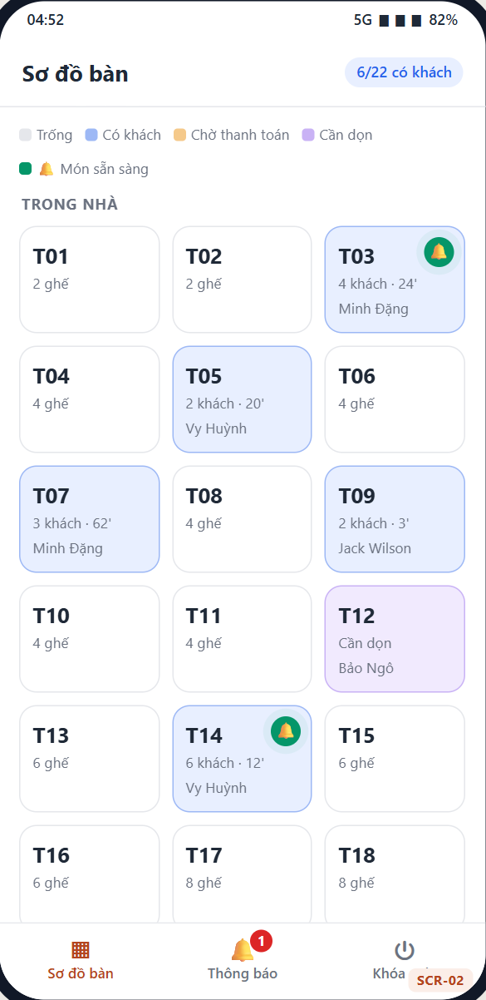 |
| SCR-03 | Gọi món | UC-01 | 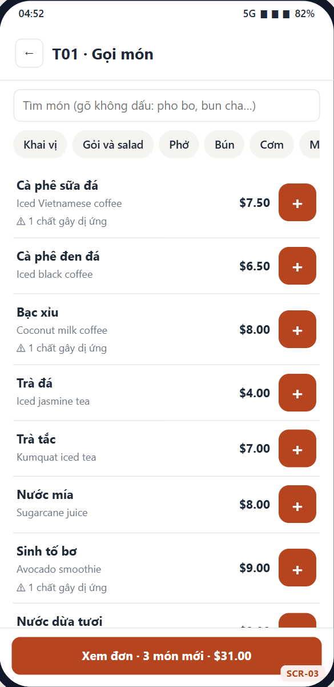 |
| SCR-04 | Chi tiết món | UC-01 | 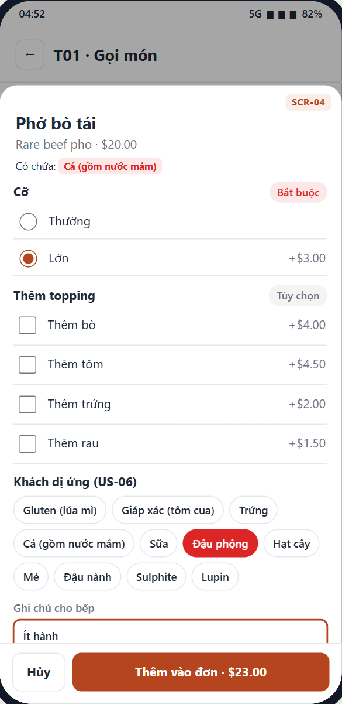 |
| SCR-07 | KDS theo trạm | UC-03 | 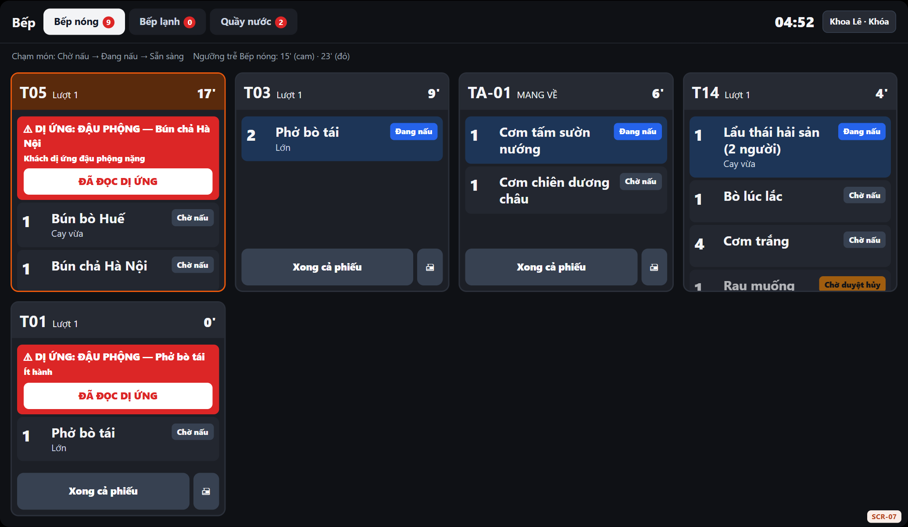 |
| SCR-11 | Thanh toán | UC-05 | 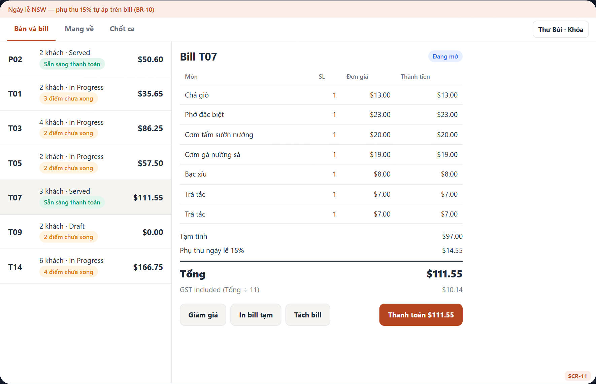 |
| SCR-15 | Báo cáo | UC-15 | 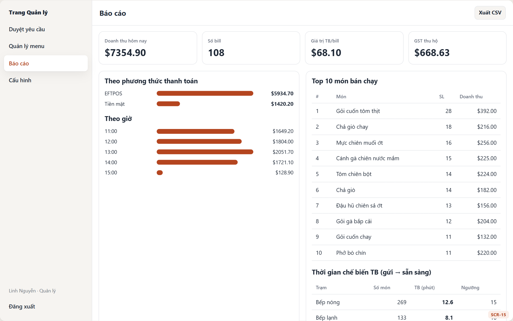 |

Đủ 19 màn hình, user flow và đánh giá UX: [Prototype](../07_UIUX/02_Prototype.md) · [Sitemap & User Flow](../07_UIUX/01_Sitemap-User-Flow.md) · [UX Evaluation](../07_UIUX/04_UX-Evaluation.md).

## 9. Giao tiếp với hệ thống và thiết bị ngoài

| Giao tiếp | Hướng | Nội dung | Ghi chú |
|---|---|---|---|
| Máy in nhiệt 80 mm | OMS → máy in (LAN) | Phiếu bếp dự phòng; bill tạm; hóa đơn; tax invoice | Mẫu in theo BR-16 |
| Máy EFTPOS | Không kết nối | Thu ngân quẹt thẻ trên máy độc lập, bấm xác nhận trên OMS | Tích hợp ở V2 (US-39) |
| Thông báo trên thiết bị | OMS → điện thoại phục vụ | Món sẵn sàng, món hết, kết quả duyệt; rung | Nhắc lại sau 2 phút |
| Xuất CSV doanh thu | OMS → Quản lý/kế toán | Cột: time, table, subtotal, discount, surcharge, total, gst, payment | Xero ở V2 (US-40) |
| Hub nội bộ ↔ cloud | Hai chiều | Đồng bộ đơn, trạng thái, menu khi có lại internet | Không mất, không trùng (NFR-06) |

## 10. Yêu cầu phi chức năng

23 NFR có chỉ số đo và tự kiểm SMART: [NFR](../02_Initial_Analysis/05_NFR.md) <!-- include: ../02_Initial_Analysis/05_NFR.md -->

## 11. Truy vết và nghiệm thu

| Tài liệu | Nội dung |
|---|---|
| [RTM](RTM.md) | BN → US → UC → Function → SCR → TC; flow UCS → TC; BR → TC |
| [UAT Test Cases](UAT-Test-Cases.md) | 99 test case, kế hoạch, defect log, báo cáo UAT |
