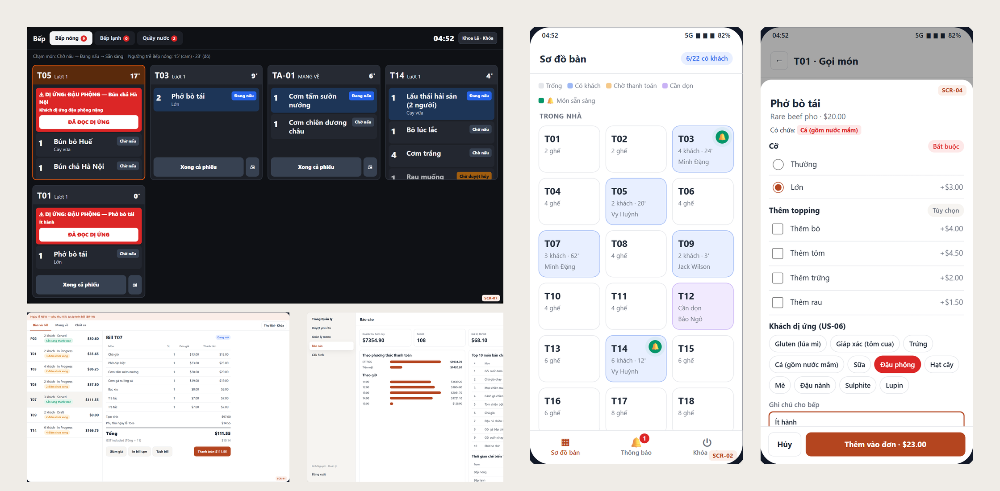
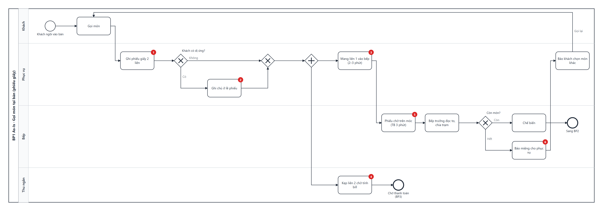
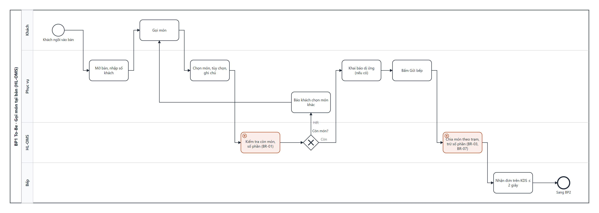
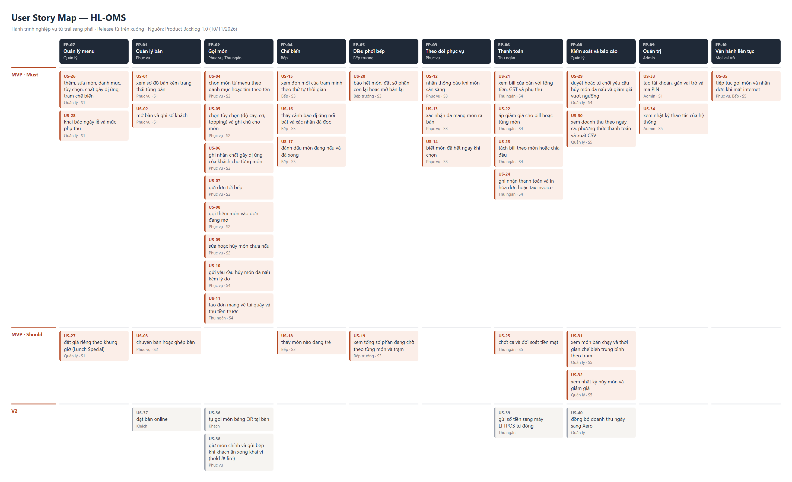
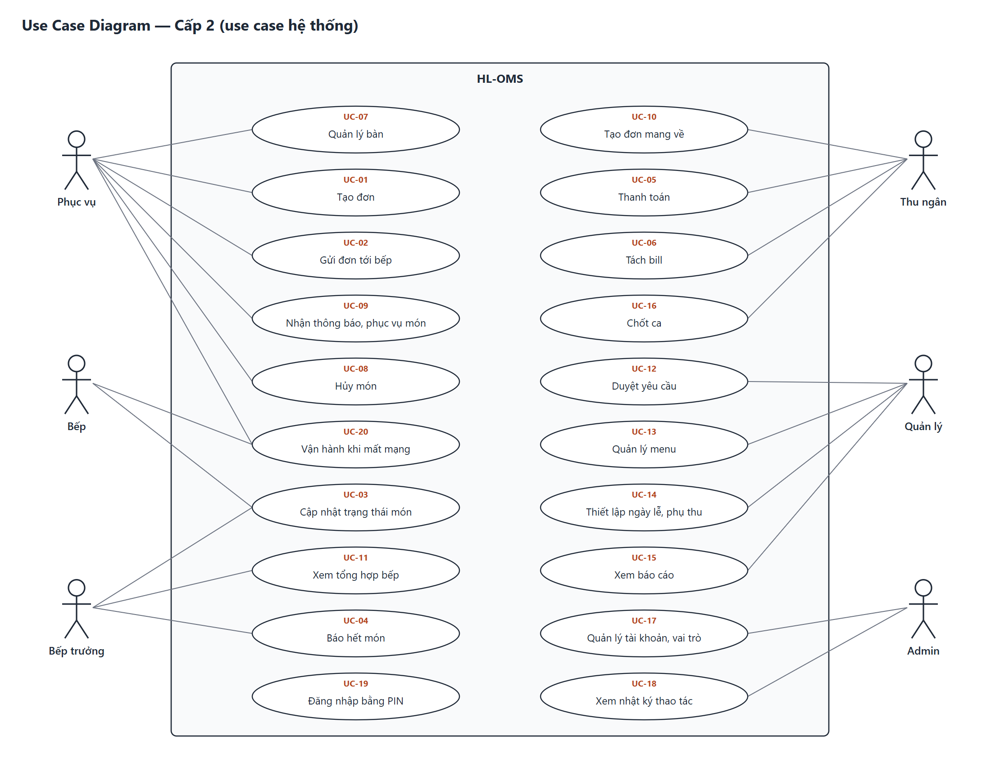
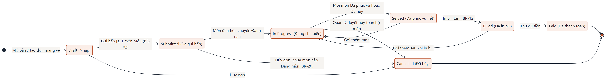
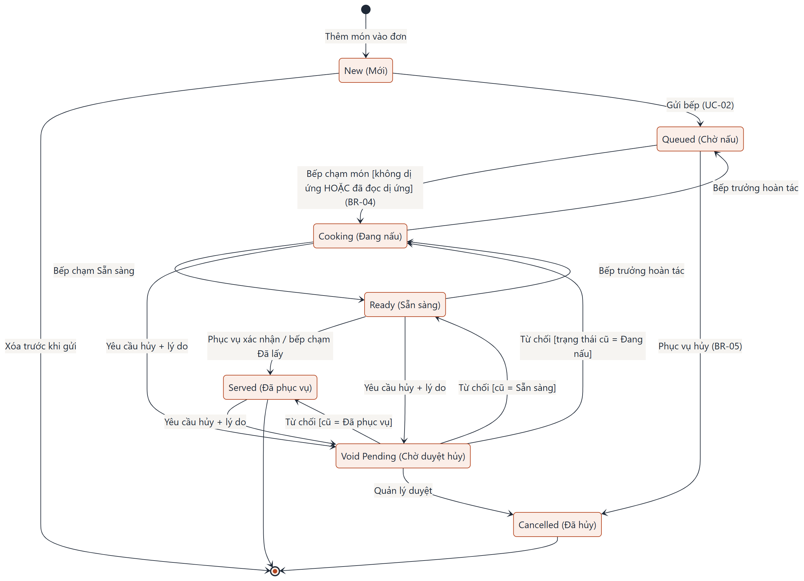

# HL-OMS — Hệ thống quản lý gọi món cho HL Restaurant

Case study Business Analysis đầy đủ chuỗi **Elicitation → User Story → Business Process → Use Case → Function & State → UI/UX → BRD/SRS/UAT → Pitching**, có ma trận truy vết tự động và prototype chạy được.


<sub>Prototype 19 màn hình: màn hình bếp (KDS) với cảnh báo dị ứng và món trễ · app phục vụ · quầy thu ngân · báo cáo quản lý</sub>

| Hạng mục | Nội dung |
|---|---|
| Khách hàng | HL Restaurant — nhà hàng Việt tại Sydney CBD, Úc (case giả lập) |
| Bài toán | Gọi món bằng phiếu giấy → sai món 3–5 lần/ngày, lên món chậm 22 phút, bill sai 1–2 lần/tuần |
| Giải pháp | Web app (PWA) 4 phân hệ: App Phục vụ · Màn hình Bếp (KDS) · Quầy Thu ngân · Trang Quản lý |
| Vai trò | Business Analyst của công ty phần mềm |
| Phương pháp | Scrum: Discovery 4 tuần + 5 sprint 2 tuần → UAT → go-live 01/03/2027 |
| Đặc thù Úc | GST 10% đã gồm trong giá · phụ thu ngày lễ NSW 15% (ACCC) · tax invoice (ATO) · 11 nhóm chất gây dị ứng (FSANZ Std 1.2.3) · dữ liệu lưu tại Úc |

## Kết quả

| Chỉ số | Giá trị |
|---|---|
| Yêu cầu | 7 Business Need · 40 User Story (35 MVP) · 73 Acceptance Criteria · 21 Business Rule · 23 NFR |
| Phân tích | 7 BPMN (As-Is/To-Be) · 20 Use Case · 7 UCS + Activity · 34 function · 5 State Machine |
| Giao diện | 19 màn hình, prototype click được, đồng bộ thời gian thực giữa các tab |
| Kiểm thử | 99 UAT test case · 100% đạt vòng 2 · 4 lỗi tìm thấy và đã sửa |
| Truy vết | 0 lỗ hổng: 35/35 story · 73/73 AC · 65/65 luồng UCS · 21/21 BR có test case |
| Kinh doanh | Chi phí năm 1 AUD 49.200 · lợi ích AUD 40.700/năm · hoàn vốn ~18 tháng · NPV 3 năm AUD 45.900 |

## Xem nhanh

| Muốn xem | Mở |
|---|---|
| Bài toán trên một trang | [BACCM](01_BACCM_Elicitation/01_BACCM.md) |
| Prototype | [07_UIUX/prototype/index.html](07_UIUX/prototype/index.html) (mở bằng Chrome/Edge, PIN demo 1234, nút "Kịch bản demo") · [ảnh 19 màn hình](07_UIUX/02_Prototype.md) |
| Tài liệu Word | [BRD](08_Documents/word/HL-OMS_BRD.docx) · [SRS](08_Documents/word/HL-OMS_SRS.docx) · [UAT](08_Documents/word/HL-OMS_UAT.docx) · [User Guide](08_Documents/word/HL-OMS_User-Guide.docx) · [Go-live Plan](08_Documents/word/HL-OMS_Go-Live-Plan.docx) |
| Ma trận truy vết | [RTM.md](08_Documents/RTM.md) · [RTM.xlsx](08_Documents/RTM.xlsx) |
| Slide | [Họp 1](01_BACCM_Elicitation/Meeting-01/02_HL-OMS_Meeting-01.pptx) · [Pitch deck](09_Pitching/HL-OMS_Pitch-Deck.pptx) |

## Hình ảnh dự án

### Quy trình: từ phiếu giấy tới đơn số

| As-Is — 6 điểm đau (chấm đỏ) | To-Be — đơn tới bếp ≤ 2 giây |
|---|---|
|  |  |

### User Story Map — 40 story, 10 Epic, 3 lớp phát hành



### Use Case và cấu trúc chức năng

| Use Case Diagram cấp 2 — 20 use case | Business Function Diagram — 34 function |
|---|---|
|  |  |

### Vòng đời đơn hàng và món

| State Machine — Order | State Machine — Order Item |
|---|---|
|  |  |

### Sitemap và luồng thanh toán

| Sitemap — 4 ứng dụng, 19 màn hình | Activity — UC-05 Thanh toán |
|---|---|
|  |  |

## Sản phẩm theo giai đoạn

| GĐ | Nội dung | Sản phẩm |
|---|---|---|
| 0 | Thiết lập | [Assumption Log](00_Admin/Assumption-Log.md) · [Question Log](00_Admin/Question-Log.md) · [Decision Log](00_Admin/Decision-Log.md) · [Change Log](00_Admin/Change-Log.md) · [Registers.xlsx](00_Admin/HL-OMS_Registers.xlsx) · [Reflection](00_Admin/Reflection.md) |
| 1 | BACCM, Elicitation | [BACCM](01_BACCM_Elicitation/01_BACCM.md) · [Elicitation Plan](01_BACCM_Elicitation/02_Elicitation-Plan.md) · [Elicitation Results](01_BACCM_Elicitation/04_Elicitation-Results.md) |
| 2 | Phương pháp | [BA Plan](00_Admin/BA-Plan.md) |
| 3 | Họp 1 | [Meeting Pack](01_BACCM_Elicitation/Meeting-01/01_Meeting-01-Pack.md) · [Slide](01_BACCM_Elicitation/Meeting-01/02_HL-OMS_Meeting-01.pptx) · [Biên bản MOM-01](01_BACCM_Elicitation/Meeting-01/03_MOM-01-Bien-ban-hop.md) |
| 4 | Phân tích khởi đầu | [Phân loại thông tin, Business Case](02_Initial_Analysis/01_Information-Classification.md) · [Stakeholder](02_Initial_Analysis/02_Stakeholder-Analysis.md) · [Risk](02_Initial_Analysis/03_Risk-Register.md) · [RACI](02_Initial_Analysis/04_RACI.md) · [NFR](02_Initial_Analysis/05_NFR.md) |
| 5 | User Story | [Product Backlog](03_User_Story/01_Product-Backlog.md) · [User Story Map](03_User_Story/02_User-Story-Map.md) |
| 6 | Business Process | [BPMN As-Is/To-Be](04_Business_Process/01_Business-Process.md) (file `.bpmn` mở bằng bpmn.io / Camunda) |
| 7 | Use Case | [Use Case Diagram](05_Use_Case_Activity/01_Use-Case-Diagram.md) · [Business Rules](05_Use_Case_Activity/02_Business-Rules.md) · [7 UCS + Activity](05_Use_Case_Activity/03_UCS) |
| 8 | Function & State | [BFD, Function/Feature List](06_Function_Feature_State/01_Function-Feature-List.md) · [State Machine](06_Function_Feature_State/02_State-Machine.md) · [Dữ liệu mẫu](06_Function_Feature_State/data) |
| 9 | UI/UX | [Sitemap, User Flow](07_UIUX/01_Sitemap-User-Flow.md) · [Prototype](07_UIUX/02_Prototype.md) · [UX Evaluation](07_UIUX/04_UX-Evaluation.md) |
| 10 | Tài liệu, Pitching | [BRD](08_Documents/BRD.md) · [SRS](08_Documents/SRS.md) · [UAT](08_Documents/UAT-Test-Cases.md) · [RTM](08_Documents/RTM.md) · [User Guide](08_Documents/User-Guide.md) · [Go-live Plan](08_Documents/Go-Live-Plan.md) · [Business Case](09_Pitching/Business-Case.md) · [Pitch deck](09_Pitching/HL-OMS_Pitch-Deck.pptx) |

## Mã truy vết

`BN` Business Need → `US` User Story (`AC` Acceptance Criteria) → `UC` Use Case (`BF`/`AF`/`EF` luồng) → `F` Function → `SCR` màn hình → `TC` test case. Kèm: `BR` Business Rule · `NFR` · `BP` quy trình · `A` giả định · `Q` câu hỏi · `D` quyết định · `CR` thay đổi · `RK` rủi ro · `MOM` biên bản · `EL` hoạt động elicitation.

## Sinh lại và kiểm tra

```bash
pip install python-pptx openpyxl python-docx pypandoc-binary playwright pillow
python tools/build_all.py      # sinh lại mọi sơ đồ, Excel, Word, slide; chạy kiểm prototype và kiểm truy vết
```

Bản nguồn là Markdown, CSV và script; `.png`, `.svg`, `.bpmn`, `.xlsx`, `.docx`, `.pptx` đều sinh từ nguồn. Script dùng Google Chrome cài trên máy để vẽ sơ đồ và chạy prototype.

> Số liệu nghiệp vụ (số bàn, số lỗi, ngân sách…), câu trả lời của stakeholder, kết quả quan sát, khảo sát và UAT là dữ liệu giả lập để thực hành, không phải của một nhà hàng có thật.
